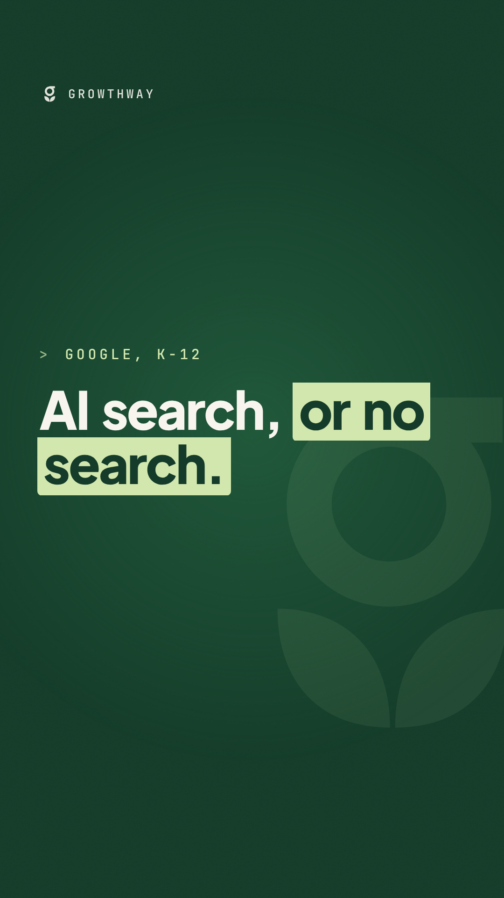

# Growthway daily brief

A new brief every weekday by 6:30am ET, with a branded reel on Tuesdays and Fridays.
Pick what you like, edit, post. Nothing here is posted automatically.
This week's briefs stay here until Monday, then move to "Last week". After that they're deleted.

## This week (from 2026-11-09)

---

## Tue, Nov 10

🎬 **Reel:** [reel.mp4](this-week/2026-11-10-tue/reel/reel.mp4) · [folder](this-week/2026-11-10-tue/reel)



```text
Google is turning Search and Gemini off for K-12 student accounts until schools switch them on, and says AI-boosted search will soon be the only Google search in its school tools. Schools that want AI off may have to give up Search.

If AI answers come with search, teachers will be the ones showing students how to use them well. "Students are going to go for the easy route. We need our teachers to teach them why that's not the right path," says Tom D'Amico, a former Ottawa Catholic director of education, to CBC.

Three habits worth teaching now 👇 and if your school wants PD on AI-assisted research, that's what we do. Link in bio.

Sources: Google, "Designing responsible AI for learning" (Nov. 3, 2026); CBC, "Google offers schools AI-boosted search or none at all" (Nov. 5, 2026).

#AIinEducation #AIliteracy #Teachers #EdTech #K12 #CanadianEducation #Growthway
```

_Quiet day: nothing new on AI and schools or on the politics side in the last 48 hours that I could verify from a primary source. Today's reel turns last week's biggest story, Google's "AI search or no search" change, into three classroom habits for teachers. No new drafts; last week's Google and budget drafts are still current if you didn't post them._

**Reel:** "AI search, or no search." What's changing for K-12 students on Google's tools, why it lands on teachers, and three habits to teach: check the AI answer, find the original source, know when to skip AI. Sources: [Google (Nov. 3)](https://blog.google/products-and-platforms/products/education/ai-learning-era-updates-2026/) and [CBC via Yahoo (Nov. 5)](https://ca.news.yahoo.com/google-offers-schools-ai-boosted-181653667.html), including the D'Amico quote in the caption.

**Watchlist:**
- **Nov. 15 to ~22:** new Ontario trustee term; first meetings, except at the eight supervised boards.
- **Budget document:** confirm the student grant change and child care lines before posting without attribution.
- **Google K-12 defaults:** watch for Canadian timing and Workspace admin details.
- **Quebec:** religious-symbols bill.
- **B.C.:** watch for cabinet and an education minister.
- **Jan. 20, 2027:** OPC Children's Privacy Code comments close.

---

## Mon, Nov 9

_Weekend scan (72 hours): budget reactions fill in what Friday's brief couldn't verify. One education story, one politics story._

**Top pick:** The university teachers' association (CAUT) says Budget 2026 has "no new measures for students or academic staff," and that without new funding the maximum Canada Student Grant "will revert to $3,000 next year" from $4,200. The budget's AI for All piece does give post-secondary students access to "trusted AI agents."

### 1. Budget 2026 gives students AI agents, but grants are set to drop · score 8/10
In a Nov. 6 release, CAUT says the maximum student grant "has not grown past $4,200, a temporary measure first promised in 2019. Without new funding, that amount will revert to $3,000 next year," with undergraduate tuition averaging $9,000 a year. It counts "at least 15,000 post-secondary jobs" lost and "over 600 programs" cut since December 2025. What the budget does include, per CAUT: longer EI benefits for apprentices (14 to 18 weeks), and under the AI for All strategy, access to "trusted AI agents" for students at universities, colleges and CEGEPs, plus 10,000 co-funded work placements. · [primary source (CAUT)](https://www.caut.ca/news/federal-budget-2026-silent-on-student-affordability-and-public-funding-shortfall-in-post-secondary-education/) · [budget key measures](https://www.canada.ca/en/department-finance/news/2026/11/budget-2026-key-measures.html)
**Why it matters:** Students get AI tools but not more help with costs. For high schools, the takeaway is that AI agents are now federal policy for post-secondary students, which raises the stakes for teaching AI use well before they get there.

⚠️ CAUT is an advocacy group; its figures are its own reading of the budget. Confirm the grant reverting to $3,000 in the budget document before stating it without attribution.

**Matt · Bluesky** (sharper)
```text
Budget 2026 gives post-secondary students "trusted AI agents." It doesn't keep their grants from falling: CAUT says the max Canada Student Grant drops from $4,200 to $3,000 next year without new money. An AI agent doesn't pay tuition.
```
**Matt · Bluesky** (more measured)
```text
Post-secondary in Budget 2026, per CAUT: AI agents for students, longer EI for apprentices, 10,000 work placements, and no new student aid, with the max grant set to fall to $3,000. Students are being prepared for an AI economy they can't afford to study for.
```
**Matt · X**
```text
Budget 2026: post-secondary students get "trusted AI agents." CAUT says the max student grant falls from $4,200 to $3,000 next year. An AI agent doesn't pay tuition.
```
**Growthway · X**
```text
Budget 2026, per CAUT: AI agents for post-secondary students and 10,000 co-funded work placements under AI for All; no new student aid, with the max Canada Student Grant set to revert to $3,000. For high schools: AI readiness starts before post-secondary. https://www.caut.ca/news/federal-budget-2026-silent-on-student-affordability-and-public-funding-shortfall-in-post-secondary-education/
```

## Politics (Matt · Bluesky only)

### P1. Budget 2026 and child care: no new money, per CUPE · score 9/10
CUPE (Nov. 6) says Budget 2026 "recycles" the $5.4-billion child care announcement made earlier this year, "delivers no new funding while allowing the child care infrastructure fund to expire," and that "without a long-term plan to recruit more workers and build new facilities, the program risks falling apart." CUPE also says the Productivity Mega Deduction will cost $36 billion over five years, more than double the annual increase in health care spending, and that the budget "sticks to the plan to cut health care funding by $1.8 billion annually." · [primary source (CUPE)](https://cupe.ca/news/budget-2026-plenty-big-investors-little-workers) · [budget key measures](https://www.canada.ca/en/department-finance/news/2026/11/budget-2026-key-measures.html)

⚠️ CUPE is a union and these are its characterizations; the federal key measures list doesn't mention child care at all, which is consistent with "no new funding." Attribute the figures to CUPE.

**Matt · Bluesky** (sharper)
```text
Budget 2026, child care: no new money and the infrastructure fund expires (CUPE). The corporate mega-deduction: $36B over five years. We found billions for the write-off and nothing new for the daycare spaces families are still waiting for.
```
**Matt · Bluesky** (more measured)
```text
$10-a-day child care only works if there are spaces and staff. CUPE says Budget 2026 adds no new child care money and lets the infrastructure fund expire. A program that's half built doesn't stay standing on its own. Free, universal child care needs a build plan.
```

**Watchlist:**
- **Budget document:** confirm the student grant change and child care lines before posting without attribution.
- **Google K-12 defaults:** watch for Canadian timing and Workspace admin details.
- **Quebec:** religious-symbols bill.
- **Nov. 15 to ~22:** new Ontario trustee term; first meetings, except at the eight supervised boards.
- **B.C.:** watch for cabinet and an education minister.
- **Jan. 20, 2027:** OPC Children's Privacy Code comments close.

---

## Last week

- [Fri, Nov 6](last-week/2026-11-06-fri/brief.md) · [reel](last-week/2026-11-06-fri/reel/reel.mp4)
- [Thu, Nov 5](last-week/2026-11-05-thu/brief.md)
- [Wed, Nov 4](last-week/2026-11-04-wed/brief.md)
- [Tue, Nov 3](last-week/2026-11-03-tue/brief.md) · [reel](last-week/2026-11-03-tue/reel/reel.mp4)
- [Mon, Nov 2](last-week/2026-11-02-mon/brief.md)
