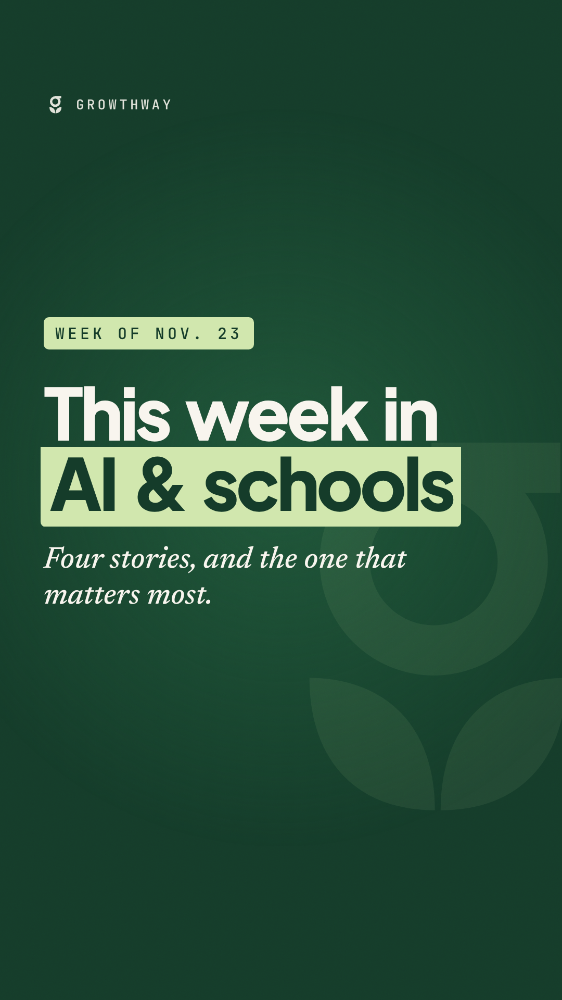
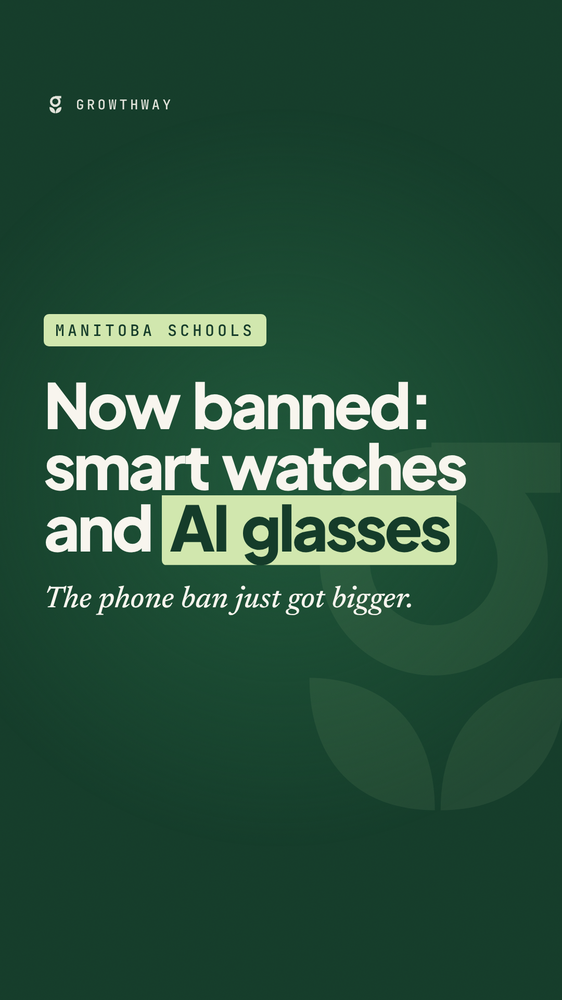
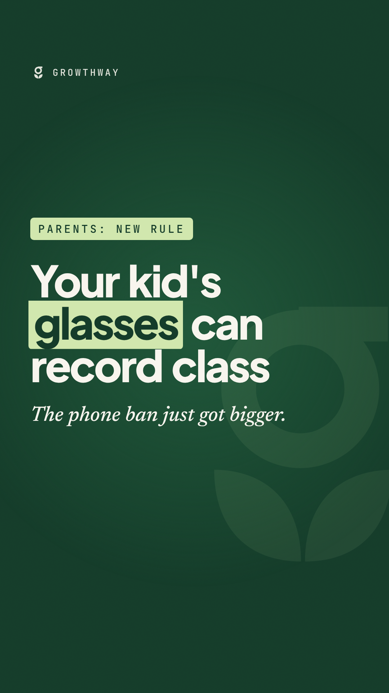

# Growthway daily brief

A new brief every weekday by 6:30am ET, with a branded reel every weekday (and carousels on Mondays and Wednesdays). Reels and carousels wait for approval in the poster dashboard (growthway-poster.netlify.app).
Pick what you like, edit, post. Nothing here is posted automatically.
This week's briefs stay here until Monday, then move to "Last week". After that they're deleted.

## This week (from 2026-11-23)

---

## Fri, Nov 27

🎬 **Reel:** [reel.mp4](this-week/2026-11-27-fri/reel/reel.mp4) · [folder](this-week/2026-11-27-fri/reel)



```text
This week in AI & schools 🇨🇦

1. Google.org is funding Experience AI training for 7,000 Canadian educators, aiming to reach an estimated 300,000 young people by 2028.
2. Manitoba added smart watches, smart glasses and other wearables, including ones with AI tools, to its school cellphone ban.
3. A Brock University survey of 441 Ontario secondary teachers: 90.7% know of students using generative AI for schoolwork, but only 15.9% rate their own skills as advanced or expert. 56% strongly agree teachers need time to work it in.
4. P.E.I.'s education minister says a "bell-to-bell" phone ban "is indeed coming."

Next up: Hour of AI Week, Dec. 7–11.

The pattern: rules for devices are moving fast. Time and training for teachers aren't keeping up. Which one would you fix first? 👇

Sources: Raspberry Pi Foundation (Nov. 20); CBC News (Nov. 24 and 26); The Conversation, Sunaina Sharma, Brock University (Nov. 26).

#AIinEducation #CanadianEducation #Teachers #CellphoneBan #Ontario #Growthway
```

**Top pick:** A Brock University survey of 441 Ontario secondary teachers: 90.7% know students are using generative AI for schoolwork, but only 15.9% rate their own skills as advanced or expert. It's the adoption–instruction gap in two numbers, from Ontario teachers themselves. Also: P.E.I. says a full-day phone ban "is indeed coming." Today's reel is the Friday roundup. The Supreme Court rules on Quebec's Bill 21 at 9:45 a.m. ET; no draft until the ruling is out.

### 1. Ontario teachers: students are ahead on AI, and only 15.9% of teachers rate themselves advanced · score 10/10
Writing in The Conversation (Nov. 26), Brock University's Sunaina Sharma reports a 2025 survey of 441 Ontario secondary teachers, supported by Brock and OSSTF: "90.7 per cent of teachers reported direct knowledge of students using GenAI for academic work." "Only 15.9 per cent of surveyed teachers rated their own GenAI proficiency as advanced or expert." "More than half of respondents (56 per cent) strongly agreed that teachers need time to integrate GenAI, while 43 per cent strongly agreed training is necessary." Teachers split: "I think trying to ban the use of GenAI in schools is pointless — it is here to stay" vs. "AI is NOT needed in education." · [The Conversation via Yahoo](https://ca.news.yahoo.com/ontario-high-school-teachers-speak-160332692.html) · [the study (Brock)](https://brocku.scholaris.ca/items/ade47ad6-45e9-4406-b04b-b4d890188f49)
**Why it matters:** It's Growthway's core point in Ontario teachers' own numbers: students moved first, teachers want time and training before anything else.

**Matt · Bluesky** (sharper)
```text
Ontario teachers, surveyed: 90.7% know students use AI for schoolwork. Only 15.9% rate their own AI skills advanced or expert. That's the whole policy problem in two numbers. Students adopted. We never gave teachers the time or training to catch up.
```
**Matt · Bluesky** (measured)
```text
New Brock survey of 441 Ontario secondary teachers: most see students using AI, few feel expert themselves, and 56% strongly agree they need time to integrate it. Before boards write more AI rules, they should budget the time teachers are asking for.
```
**Matt · X**
```text
Ontario teachers: 90.7% see students using AI for schoolwork. 15.9% rate their own AI skills advanced or expert. The gap isn't the tech. It's time and training.
```
**Growthway · X**
```text
New survey of 441 Ontario secondary teachers (Brock University): 90.7% know of students using generative AI for schoolwork; 15.9% rate their own proficiency as advanced or expert; 56% strongly agree teachers need time to integrate it. https://ca.news.yahoo.com/ontario-high-school-teachers-speak-160332692.html
```
**Instagram:** in today's roundup reel. A carousel on Monday could take it further: "What 441 Ontario teachers said about AI" (the three numbers, two teacher quotes, one question for your school).

### 2. P.E.I.: a "bell-to-bell" school phone ban "is indeed coming" · score 8/10
Education Minister Robin Croucher in the legislature (Nov. 26): "That is indeed coming... We're making some final changes to how that's going to look, but stay tuned." Today, K–6 students store phones all day; Grades 7–12 can use them at breaks (2024 directive). No date yet. · [CBC via Yahoo](https://ca.news.yahoo.com/bell-bell-ban-cellphones-schools-210734637.html)
**Why it matters:** Second province this week to tighten device rules (after Manitoba's wearables). The pattern: provinces move on devices quickly, and slowly on teacher time and AI teaching.

**Matt · Bluesky**
```text
P.E.I. says a full-day school phone ban "is indeed coming." Manitoba just added AI glasses. Provinces are moving fast on devices. I'd like to see the same urgency on the other half: time and training for teachers to teach kids to use AI well.
```
**Matt · X**
```text
P.E.I.: full-day school phone ban "is indeed coming." Provinces are fast on devices. Teacher time and AI training? Still waiting.
```
**Growthway · X**
```text
P.E.I.'s education minister says a "bell-to-bell" school cellphone ban is coming; details are still being finalized. Today, K–6 phones are stored all day and Grades 7–12 can use them at breaks. https://ca.news.yahoo.com/bell-bell-ban-cellphones-schools-210734637.html
```

## Politics (Matt · Bluesky only)
Nothing scored 7+ with a confirmed outcome at brief time. The big one lands at **9:45 a.m. ET today**: the Supreme Court of Canada's ruling on Quebec's Bill 21 (religious symbols for public employees, including teachers, and how far the notwithstanding clause can go). Read the judgment before posting; it bears directly on teachers. [CBC preview](https://www.cbc.ca/news/politics/supreme-court-decison-bill-21-9.7437512)

## Hooks and formats to borrow

**From your saves**
- **@zephzoid** (Topic, saved yesterday): a personal account, so Instagram won't share its numbers, and there's no note yet. Add a line on what caught your eye and the Monday brief will turn it into a reel idea.
- **instagram.com/reel/DgK8GmqvzLJ** (no author or note yet): add the @author on the card to pull its views.

**From the research** (same five outliers as yesterday; nothing new crossed 3× in the last day)
- **@jonathanhaidt, 23×:** a whole book in two numbered beats. Borrow for Monday's carousel: the Ontario survey "in three numbers."
- **@briskteaching, 5.9×:** a timed promise in the hook ("in 20 seconds"). Borrow: "Your school's AI rules in 3 questions" as a `search` reel.

**Watchlist:**
- **Today, 9:45 a.m. ET:** Supreme Court ruling on Bill 21.
- **Mon., Nov. 30:** CTF/FCE national educator AI survey closes; CUPE-OSBCU central bargaining.
- **P.E.I.:** details and date for the full-day phone ban.
- **B.C.:** timelines for letter grades, provincial exams and the SOGI replacement material.
- **Dec. 7–11:** Hour of AI Week. **Dec. 7:** federal by-elections.

---

## Thu, Nov 26

🎬 **Reel:** [reel.mp4](this-week/2026-11-26-thu/reel/reel.mp4) · [folder](this-week/2026-11-26-thu/reel)



```text
Manitoba just added smart watches, smart glasses and other wearables to its school cellphone ban.

The education minister's Nov. 17 letter to superintendents covers devices with "messaging, social media, internet browsing, photography, audio or video recording, artificial intelligence tools, or other cellphone-like functions." The phone ban itself has been in place since September 2024. Hanover School Division banned smart glasses a week earlier, warning parents they "can record audio and video without others readily knowing."

Minister Tracy Schmidt: "As technology evolves, so must our guidelines to ensure students are learning in healthy, safe environments."

Wherever you are: does your school's phone policy say anything about watches and glasses? If it only names phones, it's already out of date. 👇 Tell us what your school's rule covers.

Source: CBC News (Nov. 24, 2026).

#Manitoba #CellphoneBan #SmartGlasses #AIinEducation #CanadianEducation #Growthway
```

🅱️ **A/B variant:** [reel-b.mp4](this-week/2026-11-26-thu/reel-b/reel.mp4) · 

**Top pick:** Manitoba added smart watches and AI glasses to its school phone ban. It's the first Canadian province to name AI wearables in a school rule, and it gives every school a practical question to ask: does our policy cover the next device, or only phones? Today's reel. Also: B.C.'s new mandate letter brings back letter grades in Grades 4–9 and supervised provincial exams. On politics, B.C. pulled SOGI 123 from government resources and schools.

### 1. Manitoba bans smart watches and AI glasses in schools · score 9/10
Manitoba's education minister sent a Nov. 17 letter to all superintendents (and publicly funded independent schools) adding smart glasses, smart watches and other wearables to the school cellphone ban, in place since September 2024. It covers devices with "messaging, social media, internet browsing, photography, audio or video recording, artificial intelligence tools, or other cellphone-like functions." It came a week after Hanover School Division banned smart glasses, telling parents they "can record audio and video without others readily knowing." Minister Tracy Schmidt: "As technology evolves, so must our guidelines to ensure students are learning in healthy, safe environments." No exceptions are described; MediaSmarts' Kara Brisson-Boivin noted students with visual or hearing impairments "could be aided" by the technology. · [CBC News, Nov. 24](https://ca.news.yahoo.com/smart-watches-glasses-no-longer-183033392.html) · [CBC (Cina Radio copy)](https://www.cinaradio.com/2026/11/24/smart-watches-and-glasses-no-longer-allowed-in-manitoba-schools/)
**Why it matters:** Most school phone rules name phones. Wearables with cameras and AI are already here, so a rule written for the last device ages fast. And a ban with no accessibility exception will hit the students the tech helps most.

**Matt · Bluesky** (sharper)
```text
Manitoba just added smart watches and AI glasses to its school phone ban. Fair: glasses that record without anyone noticing don't belong in a classroom. But every school that wrote a "phone" policy is now a device behind. Write rules for functions (recording, AI, messaging), not gadgets.
```
**Matt · Bluesky** (measured)
```text
Manitoba now bans smart watches and AI glasses in schools, not just phones. Sensible on privacy. Two things to watch: an exception for students who use these tools for vision or hearing, and whether other provinces update phone-only rules before the next device shows up.
```
**Matt · X**
```text
Manitoba added smart watches and AI glasses to its school phone ban. Most provinces' rules still say "phones." Write the rule for what a device does (record, message, run AI), not what it's called.
```
**Growthway · X**
```text
Manitoba has added smart watches, smart glasses and other wearables to its school cellphone ban. The directive covers devices with recording, messaging, social media or AI tools. Worth checking: does your school's policy cover wearables, and is there an accessibility exception? https://ca.news.yahoo.com/smart-watches-glasses-no-longer-183033392.html
```
**Instagram:** today's reel (sticky notes, A/B trial pair).

### 2. B.C. mandate letter: letter grades back for Grades 4–9, plus supervised provincial exams · score 8/10
The new education minister's mandate letter (released Nov. 24–25) lists, under Education: "Restore letter grades for Grades 4–9 and supervised provincial examinations" and "Prioritize evidence-based literacy, mathematics and foundational learning." No timeline is given in the letter. · [Mandate letter, Minister Lynne Block (PDF)](https://www2.gov.bc.ca/assets/gov/government/ministries-organizations/premier-cabinet-mlas/minister-letter/mandate_letter_lynne_block.pdf) · [B.C. release, Nov. 24](https://news.gov.bc.ca/releases/2026PREM0072-001146) · [CHEK News](https://cheknews.ca/rob-shaw-b-c-conservatives-begin-implementing-return-to-office-and-repealing-sogi-election-promises-1364274/)
**Why it matters:** Assessment changes land on teachers and on report cards parents read. Switching reporting systems mid-stream needs a timeline, training and a plain-language explanation for families. Growthway's angle: what parents should ask their school, not whether grades are good or bad.

**Matt · Bluesky**
```text
B.C.'s new government will bring back letter grades for Grades 4–9 and supervised provincial exams. Whatever you think of the change, the question is how: when, with what training for teachers, and how it's explained to parents. The mandate letter doesn't say yet.
```
**Matt · X**
```text
B.C. will restore letter grades for Grades 4–9 and supervised provincial exams (new mandate letter). No timeline yet. Teachers and parents need one before the next report card.
```
**Growthway · X**
```text
B.C.'s new education mandate letter: "Restore letter grades for Grades 4–9 and supervised provincial examinations." No timeline is given yet. B.C. families and teachers: watch for the ministry's implementation plan. https://www2.gov.bc.ca/assets/gov/government/ministries-organizations/premier-cabinet-mlas/minister-letter/mandate_letter_lynne_block.pdf
```

_Hold suggestion for Growthway: post once the ministry gives a timeline, unless B.C. followers are asking now._

## Politics (Matt · Bluesky only)

### P1. B.C. pulls SOGI 123 from government resources and schools · score 9/10
In a Nov. 25 release, the Premier's office said "Effective immediately, the Province is removing SOGI 123 material from government websites and resources and will work to remove it from schools." Premier Lorne Doerkson: "SOGI has become a lightning rod of division in this province." Minister Lynne Block: "Every student in B.C. should be able to go to school and feel safe, and we will strengthen measures to protect all students." The mandate letter says "Repeal SOGI 123 and address bullying directly, protecting students from harassment based on personal characteristics." CHEK reports it "will be replaced by other anti-bullying and safety material." · [B.C. release, Nov. 25](https://news.gov.bc.ca/releases/2026PREM0039-001148) · [CHEK News](https://cheknews.ca/rob-shaw-b-c-conservatives-begin-implementing-return-to-office-and-repealing-sogi-election-promises-1364274/)

_Flag: sharply criticizes the B.C. education ministry, which Growthway may work with. Keep it on the policy (what replaces it, and when), not on people._

**Matt · Bluesky** (sharper)
```text
B.C. pulled SOGI 123 "effective immediately," with replacement anti-bullying material still to come. Removing a resource teachers use before the replacement exists isn't a plan for safer schools. It's a gap, and 2SLGBTQ+ kids are the ones standing in it.
```
**Matt · Bluesky** (measured)
```text
B.C.'s minister says every student "should be able to go to school and feel safe." Then the replacement for SOGI 123 should be ready before the old material comes out of schools. What is it, when does it arrive, and who wrote it?
```

## Parreira.ca episode pitches

### "If I was B.C.'s education minister" · politics
**Hook:** Board of provincial ministers' faces; Matt taps Lynne Block's (official portrait). "Day one."
**Tension:** The mandate letter says "Restore letter grades for Grades 4–9 and supervised provincial examinations" and "Repeal SOGI 123" ([mandate letter](https://www2.gov.bc.ca/assets/gov/government/ministries-organizations/premier-cabinet-mlas/minister-letter/mandate_letter_lynne_block.pdf)). SOGI material was removed "effective immediately" ([B.C. release, Nov. 25](https://news.gov.bc.ca/releases/2026PREM0039-001148)).
**Moves:** First, publish the replacement anti-bullying resource before pulling anything else / Then, give grades a real rollout: a date, teacher training and a one-page parent explainer / Finally, one provincial rule on AI and devices, written for functions, not gadgets.
**Screen:** "Mandate letter" document sticker with the two lines highlighted · a calendar with "replacement: ?" · report card going A–F · a smart-glasses icon with "next device" · "Comment who I should take on next."

### "If I launched a device-policy service for schools" · business
**Hook:** Board of gadgets (phone, watch, glasses); Matt taps the glasses. "This one's the problem."
**Tension:** Manitoba's ban, in place since September 2024, now had to add wearables with "photography, audio or video recording, artificial intelligence tools" ([CBC, Nov. 24](https://ca.news.yahoo.com/smart-watches-glasses-no-longer-183033392.html)).
**Moves:** First, a model policy that bans functions, not brands, with an accessibility exception / Then, a parent letter and a staff one-pager per board / Finally, a yearly update subscription when the next device lands.
**Screen:** Phone → watch → glasses on a conveyor · "Policy v1 / v2 / v3" stamps · price tag "concept" · "Not financial advice."

### "If I ran a faculty of education" · post-secondary
**Hook:** Board of university crests ("before" logos); Matt taps a generic "Faculty of Education" card (label "concept").
**Tension:** Manitoba had to update a 2024 phone ban for AI glasses within two years ([CBC](https://ca.news.yahoo.com/smart-watches-glasses-no-longer-183033392.html)); B.C. is switching grading systems again ([mandate letter](https://www2.gov.bc.ca/assets/gov/government/ministries-organizations/premier-cabinet-mlas/minister-letter/mandate_letter_lynne_block.pdf)).
**Moves:** First, every teacher candidate writes a classroom tech policy and defends it / Then, an assessment lab: the same work marked on a proficiency scale and with letter grades / Finally, a standing "new device" clinic that updates graduates each year.
**Screen:** Graduation cap with a "v2026" sticker · split report card · glasses icon · "Comment what I should run next."

## Hooks and formats to borrow
From the last 14 days of the comp accounts (outlier = views ÷ that account's median):
- **@jonathanhaidt, 23× (1.46M views):** a one-reel summary of a whole book, structured as "two big changes" with numbered emoji beats. Borrow: a "Here's the whole report in 30 seconds" reel when a big report lands (PISA, KPMG), told as 2–3 beats in `notes`.
- **@edpuzzle, 14.6× (35K):** a teacher-humour reel riding a pop-culture moment (#gta6), with the caption "Engagement was through the roof." Borrow: a light, relatable teacher moment tied to something trending, once in a while, to reach beyond the policy crowd.
- **@briskteaching, 5.9× (7.3K):** a concrete promise with a time in the hook: "Turn any reading passage into a custom worksheet in 20 seconds." Borrow: a `search` reel with a specific, timed outcome ("Set up your school's AI rules in 3 questions").
- **@edutopia, 3.9× (165K):** a teacher quote up top, then a 10-minute classroom routine. Borrow: a `fineprint`-style reel quoting a real Canadian teacher (with permission) and the routine they use.
- **@jonathanhaidt, 3.7× (231K):** a worry stated plainly ("we're losing our capacity to read books"). Borrow: a `mythfact` that opens on a common parent worry and answers it with a source.

**Watchlist:**
- **Fri., Nov. 27:** Supreme Court of Canada decision on Quebec's Bill 21 expected.
- **Mon., Nov. 30:** CTF/FCE national educator AI survey closes; CUPE-OSBCU central bargaining in Ontario.
- **This week:** Ontario central bargaining; Bill 143 at the finance committee.
- **B.C.:** implementation timelines for letter grades, provincial exams and the SOGI replacement material.
- **Federal:** reports of a national AI literacy program rolling out in December under the AI strategy; not yet confirmed against an ISED release.
- **Dec. 7–11:** Hour of AI Week. **Dec. 7:** federal by-elections in six ridings.

---

## Wed, Nov 25

**Top pick:** Quiet day for schools. The useful item: Hour of AI Week runs Dec. 7–11, and Ampere and Canada Learning Code are offering free classroom resources and virtual AI workshops for educators. It's a practical, positive post for teachers two weeks out. On politics, Ontario's Bill 143 just got bigger: universities say it could put property tax on up to 12,000 student homes.

### 1. Hour of AI Week, Dec. 7–11: free AI literacy resources for Canadian classrooms · score 7/10
Ampere and Canada Learning Code (Nov. 24) will run AI literacy activities during Hour of AI Week, Dec. 7–11, part of Computer Science Education Week. Hour of AI "is a global initiative led by CodeAI." They're offering "free classroom resources" (CodeAI activities and lesson plans, Ampere's AI Glossary), virtual AI workshops for educators and adult learners including an Indigenous perspective on AI, and in-person sessions at makerspaces. Details at amp.ca/teachers/hour-of-ai. · [Release](https://www.newswire.ca/news-releases/ampere-and-canada-learning-code-bring-national-ai-literacy-initiative-to-classrooms-across-canada-853821017.html)
**Why it matters:** A low-effort way for a school to start teaching how AI works, with a fixed date to plan around. Pair it with the bigger question: what's the school's plan after the one-hour lesson?

**Matt · Bluesky**
```text
Hour of AI Week is Dec. 7–11, with free Canadian classroom resources from Ampere and Canada Learning Code, including an Indigenous perspective on AI. One hour won't make kids AI-literate. But it's a good place for a school to start the conversation it's been putting off.
```
**Matt · X**
```text
Hour of AI Week is Dec. 7–11. Free classroom resources and educator workshops from Ampere and Canada Learning Code. One hour isn't AI literacy, but it's a start.
```
**Growthway · X**
```text
Teachers: Hour of AI Week runs Dec. 7–11. Ampere and Canada Learning Code are offering free classroom resources, an AI glossary and virtual educator workshops (including an Indigenous perspective on AI). https://www.newswire.ca/news-releases/ampere-and-canada-learning-code-bring-national-ai-literacy-initiative-to-classrooms-across-canada-853821017.html
```

## Politics (Matt · Bluesky only)

### P1. Bill 143 now hits student housing too: universities warn of tax on up to 12,000 student homes · score 8/10
New since yesterday: the Council of Ontario Universities' Steve Orsini told a Queen's Park committee that up to 12,000 existing student homes would have to pay property tax if Bill 143 passes, and another 10,000 planned student homes could be put in jeopardy. Global News reports the bill would end the exemption for some providers, "including charitable providers and student residences," in 2027. NDP finance critic Jessica Bell: "It doesn't make any sense to me." A lawyer for Indigenous housing providers says it's coming "without any meaningful consultation." The government calls it a "temporary pause" after a June 2025 Court of Appeal ruling and says existing exemptions stay. · [Global News](https://globalnews.ca/news/12164088/ontario-property-tax-change-could-hike-affordable-housing-costs-critics/) · [CP24 (yesterday)](https://cp24.com/politics/queens-park/2026/11/23/non-profits-fear-housing-halt-as-ontario-bill-targets-tax-exemption)

_Flag: criticizes the Ontario government. Ties to Matt's post-secondary and housing positions; if you posted on Bill 143 yesterday, this is a follow-up rather than a new post._

**Matt · Bluesky** (sharper)
```text
Update on Ontario's Bill 143: it's not just non-profit housing. Universities say up to 12,000 student homes could start paying property tax, and 10,000 planned ones are at risk. In a housing crisis, taxing student homes is the opposite of a plan.
```
**Matt · Bluesky** (measured)
```text
Ontario's Bill 143 would pause property tax exemptions for affordable and student housing in 2027. Universities say up to 12,000 student homes could be taxed and 10,000 planned ones put at risk. If it's a "temporary pause" for consultation, consult first, then legislate.
```

**Watchlist:**
- **This week:** Ontario central bargaining; Bill 143 at the finance committee.
- **Fri., Nov. 27:** Supreme Court of Canada decision on Quebec's Bill 21 expected.
- **B.C.:** mandate letters for the new cabinet. A Vancouver parents' group (PACES) asked for a two-year pause on generative AI in classrooms; their newsletter says the previous ministry rejected it. Watch whether Minister Lynne Block revisits it.
- **Nov. 30:** CTF/FCE national educator AI survey closes.
- **Dec. 7–11:** Hour of AI Week.
- **Dec. 7:** federal by-elections in six ridings.

---

## Tue, Nov 24

🎬 **Reel:** [reel.mp4](this-week/2026-11-24-tue/reel/reel.mp4) · [folder](this-week/2026-11-24-tue/reel)


```text
Two Google stories this week, and both land in your school.

1. Google.org is funding over $7M CAD for Canadian youth safety and AI literacy non-profits. Part of it ($2M) lets the Raspberry Pi Foundation, Actua and Digital Moment train 7,000 Canadian educators in Experience AI, a free AI education program, aiming to reach an estimated 300,000 young people by 2028.
2. More than 540 Google employees and contractors signed a petition asking the company to let schools keep Google Search but turn off the AI answers (reported by Bloomberg).

Meanwhile, Google's AI tools go off by default for K-12 student accounts in early 2027, and keeping plain Search means accepting AI features.

Free training is good news. Your school still has to decide what gets switched on. Three questions to ask 👇 and if your school wants help with that plan, that's what we do. Link in bio.

Sources: Google Canada; Raspberry Pi Foundation (Nov. 20, 2026); iPhone in Canada citing Bloomberg (Nov. 20, 2026); The Conversation (Nov. 17, 2026).

#AIinEducation #AIliteracy #K12 #GoogleForEducation #CanadianEducation #Growthway
```

**Top pick:** The Raspberry Pi Foundation says Google.org's money will train 7,000 Canadian educators in Experience AI, a free AI education program, reaching an estimated 300,000 young people by 2028. That's concrete, free PD schools can act on now, and today's reel ties it to the Search-or-AI decision. On the politics side, Ontario's fall budget bill would pause a property tax exemption that non-profits say keeps affordable housing viable.

### 1. Free AI training for 7,000 Canadian educators by 2028 · score 8/10
The Raspberry Pi Foundation (Nov. 20) will "expand Experience AI across Canada to train 7,000 educators who will reach an estimated 300,000 young people across the country by 2028," with $2 million from Google.org, working with Actua and Digital Moment. It describes Experience AI as "a free educational programme that helps teachers and students learn about artificial intelligence." A 2023 Canadian pilot with Digital Moment reached 500 educators and an estimated 56,000 young people. This is part of the Google.org Canada package covered yesterday. · [Raspberry Pi Foundation](https://www.raspberrypi.org/blog/bringing-ai-education-to-300000-young-people-across-canada/) · [Google Canada](https://blog.google/intl/en-ca/company-news/outreach-initiatives/empowering-canadian-youth-families-and-educators/)
**Why it matters:** Teacher training is the real gap, and this is free. But free lessons on how AI works don't replace a school's own plan: policy, what gets switched on, and how assessment changes. Useful to share, with that framing.

**Matt · Bluesky** (sharper)
```text
Free AI training for 7,000 Canadian teachers by 2028, funded by Google.org. Take it. But notice who's paying to teach our kids about AI: the company setting the AI defaults in their classrooms. Provinces should be funding this themselves, with their own standards.
```
**Matt · Bluesky** (measured)
```text
7,000 Canadian educators will get free AI training by 2028 through Experience AI (Raspberry Pi Foundation, Actua, Digital Moment). Good news: training is the real gap. It still needs to sit inside a school's own plan for what AI gets used, and how.
```
**Matt · X**
```text
Free AI training for 7,000 Canadian educators by 2028 (Raspberry Pi Foundation, Actua, Digital Moment, Google.org funding). Training is the real gap. Schools still need their own plan.
```
**Growthway · X**
```text
Teachers: Experience AI, a free AI education program, is expanding across Canada to train 7,000 educators by 2028 (Raspberry Pi Foundation with Actua and Digital Moment). https://www.raspberrypi.org/blog/bringing-ai-education-to-300000-young-people-across-canada/
```

### 2. B.C. names a new education and child care minister · score 7/10
Premier Lorne Doerkson was sworn in Nov. 20 with B.C.'s first Conservative cabinet since 1928. Lynne Block is Minister of Education and Child Care; Korky Neufeld heads a combined Post-Secondary Education and Labour ministry. The government's five priorities include "strengthening education and families" under "A Strong and Proud B.C." No education mandate has been published yet. · [Global News](https://globalnews.ca/news/12159369/lorne-doerkson-swearing-in/)
**Why it matters:** A new minister means B.C.'s AI guidance, phone rules and child care plans are all open questions. Worth a neutral "who's who" post and a watch on the mandate letter.

**Matt · Bluesky**
```text
B.C.'s new education and child care minister is Lynne Block. First question I'd ask: does $10-a-day child care keep expanding as public spaces? Second: does B.C. keep building on its AI guidance for schools? Watching for the mandate letter.
```
**Matt · X**
```text
B.C.'s new Minister of Education and Child Care: Lynne Block. Two questions: does $10-a-day keep expanding as public spaces, and what happens to B.C.'s school AI guidance?
```
**Growthway · X**
```text
B.C. has a new Minister of Education and Child Care: Lynne Block, sworn in Nov. 20 with Premier Lorne Doerkson's cabinet. Post-secondary moves into a combined ministry with Labour under Korky Neufeld. https://globalnews.ca/news/12159369/lorne-doerkson-swearing-in/
```

🎬 **Reel (Tuesday explainer):** "Two Google stories": 7,000 educators to get free Experience AI training; 540+ Google staff asking to keep Search without AI answers; Google's early-2027 default ("Want search? Accept the AI."); three questions for your school. 6 scenes, 28.2s. Sources on screen and in the caption.

## Politics (Matt · Bluesky only)

### P1. Ontario's budget bill would pause a tax exemption non-profits say affordable housing depends on · score 9/10
Bill 143, the "Plan to Protect Ontario Act (Budget Measures), 2026 (No. 2)," amends the Assessment Act in a way critics say will suspend a property tax exemption for rental housing starting in 2027. Lawyers for 24 non-profit housing agencies (including United Way Elgin Middlesex, Indwell and CMHA Thames Valley) say property taxes can be "approximately one-third of an affordable housing provider's operating costs," and warn of "a stoppage in the development of affordable housing in Ontario." Properties already exempt keep it; projects in development would lose it. The Finance Ministry calls it a temporary pause for consultations and points to an optional municipal reduction of up to 35%. The bill has passed second reading and is at committee. · [CP24 / CTV London](https://cp24.com/politics/queens-park/2026/11/23/non-profits-fear-housing-halt-as-ontario-bill-targets-tax-exemption)

_Flag: both takes criticize the Ontario government. Weigh against Growthway's Ontario relationships._

**Matt · Bluesky** (sharper)
```text
In a housing crisis, Ontario's budget bill would pause the property tax exemption that keeps non-profit affordable housing viable. Taxes can be a third of a provider's operating costs. 24 agencies say projects will stop. Kill this clause at committee.
```
**Matt · Bluesky** (measured)
```text
Ontario's Bill 143 would pause a property tax exemption for affordable rental housing from 2027. Non-profits say taxes can be a third of their operating costs, and projects in progress would lose it. A 35% optional municipal discount isn't the same thing. Fix it at committee.
```

**Watchlist:**
- **This week:** Ontario central bargaining sessions; Bill 143 at the finance committee.
- **Fri., Nov. 27:** Supreme Court of Canada decision on Quebec's Bill 21 expected.
- **B.C.:** mandate letters for the new cabinet, especially Education and Child Care.
- **Nov. 30:** CTF/FCE national educator AI survey closes.
- **Dec. 7:** federal by-elections in six ridings.
- **Early 2027:** Google's AI-off default for K-12 student accounts.

---

## Mon, Nov 23

**Top pick:** Google is funding AI literacy in Canada (over $7M CAD from Google.org to more than a dozen non-profits, aiming to reach 550,000+ youth and educators) in the same week more than 540 of its own employees and contractors asked it to let schools keep Search without the AI answers. That's the tension schools are living in, and a strong, non-partisan Growthway story.

### 1. Google funds Canadian AI literacy as its own workers push back on AI-or-no-Search for schools · score 9/10
Google Canada says Google.org is providing "over $7M CAD in funding... to over a dozen Canadian non-profit organizations," which "will reach over 550,000 Canadian youth and educators." The AI literacy share includes Actua and Digital Moment working with the Raspberry Pi Foundation on Experience AI, Community AI Literacy Grants (Pathways to Education, Amii, Simon Fraser University, the Society for Arts and Technology, and public library foundations in Calgary and Vancouver), and MediaSmarts. Separately, a petition organized by the Alphabet Workers Union and signed by "more than 540 Google employees and contractors," public Nov. 19, asks Google to let schools "keep Google Search, but turn off the AI answers." · [Google Canada](https://blog.google/intl/en-ca/company-news/outreach-initiatives/empowering-canadian-youth-families-and-educators/) · [iPhone in Canada, citing Bloomberg](https://www.iphoneincanada.ca/2026/11/20/google-workers-school-search-without-ai/)
**Why it matters:** The funding is good news for programs schools already use. But AI literacy for 550,000 people doesn't settle the question in front of every board: what to switch on before Google's default changes. And even Google's staff think "AI or no Search" is the wrong choice to force.

_The petition is reported secondhand (Bloomberg via iPhone in Canada); I didn't open Bloomberg._

**Matt · Bluesky** (sharper)
```text
Google is funding AI literacy for 550,000 Canadian youth and educators. Good. Also this week: 540+ of its own staff asked it to let schools keep Search without AI answers. Teach AI literacy, sure, but don't make "accept our AI or lose search" the lesson.
```
**Matt · Bluesky** (measured)
```text
Two Google stories this week: $7M+ for Canadian AI literacy and online safety non-profits, and a 540+ staff petition asking to let schools keep Search without AI answers. Both point the same way: schools need real choices and real teaching, not just a default.
```
**Matt · X**
```text
Google: $7M+ for Canadian AI literacy. Also Google: 540+ staff asking it to let schools keep Search without the AI. Schools need real choices, not just funded lessons.
```
**Growthway · X**
```text
Google.org is funding over $7M CAD for Canadian youth safety and AI literacy non-profits (Actua, Digital Moment, MediaSmarts, Amii and more), aiming to reach 550,000+ youth and educators. Details: https://blog.google/intl/en-ca/company-news/outreach-initiatives/empowering-canadian-youth-families-and-educators/
```
**Instagram** carousel, "Google, AI and your school":
1. Two Google stories this week, pointing in different directions.
2. $7M+ for Canadian non-profits teaching online safety and AI literacy.
3. Programs you may know: MediaSmarts, Kids Help Phone, Actua, BGC Canada.
4. Meanwhile, 540+ Google staff asked: let schools keep Search without AI answers.
5. Why it matters: schools still have to decide what gets switched on.
6. Ask your school: what's our plan before Google's default changes?

### 2. Labour Board rules on Ontario bargaining; minister: "absolutely no imminent strike threat" · score 8/10
All five Ontario education unions now hold strike mandates, "ranging from 94 to 98 per cent." On Nov. 18 the Ontario Labour Relations Board "issued a decision clarifying which issues can be negotiated centrally and which must be addressed locally, clearing the way for substantive bargaining to resume." Education Minister Paul Calandra: "There's absolutely no imminent strike threat because there's a number of processes that have to be put in place before that can even start." OECTA's president said job action before Christmas would be "highly unlikely." A legal strike requires conciliation and a no-board report, then a 17-day countdown and at least five days' notice. · [CP24](https://www.cp24.com/local/toronto/2026/11/20/all-five-of-ontarios-education-unions-now-have-strike-mandates-here-is-what-that-could-mean-for-students/)
**Why it matters:** This is the explainer parents need: talks are finally moving, and several legal steps stand between a mandate and any job action. Growthway can share the process without taking a side.

**Matt · Bluesky**
```text
The Labour Board has finally ruled on what Ontario's education unions bargain centrally, so talks can actually start. Five strike mandates, 94–98%. The minister says there's no imminent strike. Then use the time: class sizes, special-needs supports, mental health. Get a deal.
```
**Matt · X**
```text
Ontario's Labour Board ruled Nov. 18; education bargaining can finally start. Five strike mandates, 94–98%. No imminent strike, says the minister. Use the time and get a deal.
```
**Growthway · X**
```text
Ontario parents: the Labour Relations Board ruled Nov. 18 on what's bargained centrally, so talks can resume. A legal strike still needs conciliation, a no-board report, a 17-day countdown and 5 days' notice. https://www.cp24.com/local/toronto/2026/11/20/all-five-of-ontarios-education-unions-now-have-strike-mandates-here-is-what-that-could-mean-for-students/
```

_No politics section today: nothing new reached 7. The Supreme Court's Bill 21 ruling (Friday) is the one to prepare for; see the watchlist._

**Watchlist:**
- **This week:** Ontario central bargaining sessions begin (ETFO says Thursday and Friday; OSBCU Nov. 30).
- **Fri., Nov. 27:** Supreme Court of Canada expected to release its decision on Quebec's secularism law (Bill 21), including what it means for the notwithstanding clause ([NetNewsLedger week-ahead](https://www.netnewsledger.com/2026/11/22/news-roundup-canada-headlines-court-ruling-ahead-as-auto-defence-and-climate-questions-remain/)). Likely a politics item for Matt; touches teachers too, so keep Growthway out of it.
- **Stellantis/Brampton:** Stellantis's Pablo Di Si expected in Canada this week for plant talks.
- **Nov. 30:** CTF/FCE national educator AI survey closes.
- **Dec. 7:** federal by-elections in six ridings.
- **Early 2027:** Google's AI-off default for K-12 student accounts.

---

## Last week

- [Fri, Nov 20](last-week/2026-11-20-fri/brief.md) · [reel](last-week/2026-11-20-fri/reel/reel.mp4)
- [Thu, Nov 19](last-week/2026-11-19-thu/brief.md)
- [Wed, Nov 18](last-week/2026-11-18-wed/brief.md)
- [Tue, Nov 17](last-week/2026-11-17-tue/brief.md) · [reel](last-week/2026-11-17-tue/reel/reel.mp4)
- [Mon, Nov 16](last-week/2026-11-16-mon/brief.md)
