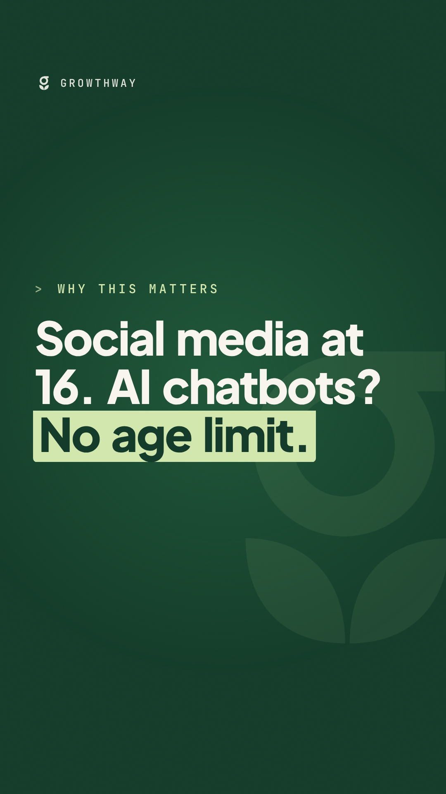

# Growthway daily brief

A new brief every weekday by 6:30am ET, with a branded reel on Tuesdays and Fridays.
Pick what you like, edit, post. Nothing here is posted automatically.
This week's briefs stay here until Monday, then move to "Last week". After that they're deleted.

## This week (from 2026-10-26)

---

## Thu, Oct 29

_Quiet day: one education story, one politics story, and the first Thursday episode pitches for Parreira.ca._

**Top pick:** About ten students at a Lévis, Que., high school were suspended for AI-altered images of staff, some "offensive, defamatory, hateful or violent," including one with a rifle to a staff member's temple. Deepfakes of staff are now a discipline issue in Canadian schools.

### 1. Lévis students suspended over AI-altered images of school staff · score 9/10
At École secondaire de l'Horizon in Lévis, about ten students were suspended for up to three days for AI-altered photos of staff shared in a private social media group named after the school. The Centre de services scolaire des Navigateurs called the images "de nature offensante, diffamatoire, haineuse ou violente"; other students reported them. Lévis police say no complaint was filed, and police and the school board deny reports of sexual deepfakes of staff. A principals' association head said using photos without permission "n'est pas quelque chose qui est tolérable" and advised staff to make their profiles private. · [primary source (Radio-Canada)](https://ici.radio-canada.ca/nouvelle/2295957/ia-eleve-photos-truquees-ecole-secondaire-levis) · [coverage (CBC)](https://www.cbc.ca/news/canada/montreal/students-suspended-levis-high-school-ai-images-9.7398634)
**Why it matters:** Schools need a plan for synthetic media before the next incident: what the rule is, how students learn about consent and harm, and how staff are protected. Suspensions alone don't teach anything.

**Matt · Bluesky** (sharper)
```text
Ten students suspended in Lévis for AI-faked images of their teachers, one with a rifle to a staff member's head. This is what happens when kids get the tools before anyone teaches them the ethics. Suspension is a consequence, not a lesson. Schools need both.
```
**Matt · Bluesky** (more measured)
```text
The Lévis deepfake case is a preview, not an outlier. Every school will face this. The question is whether we have a policy, a lesson on consent and harm, and protection for staff ready before it happens, or only a suspension after.
```
**Matt · X**
```text
Ten Lévis students suspended for AI-faked images of their teachers. Kids got the tools before anyone taught the ethics. Suspension is a consequence, not a lesson; schools need both.
```
**Growthway · X**
```text
A Lévis, Que., high school suspended about ten students for AI-altered images of staff, described as offensive, hateful or violent. What it means for schools: write a synthetic-media rule, teach consent and harm, and protect staff images. https://ici.radio-canada.ca/nouvelle/2295957/ia-eleve-photos-truquees-ecole-secondaire-levis
```
**Instagram** (carousel, "Why this matters"):
1. Students used AI to fake photos of their teachers.
2. About ten were suspended at a Lévis, Que., high school.
3. Other students reported it: that matters.
4. At home: "Would you be OK if someone did that to you?"
5. Using someone's face without permission causes real harm.
6. Schools: have a rule for AI images before you need it.
7. Growthway: plain-language AI nights for parents and staff.

## Politics (Matt · Bluesky only)

### P1. Winnipeg re-elects Scott Gillingham with about 40% · score 8/10
Gillingham won a second term on Oct. 28 with about 40% of the vote in unofficial results, roughly 20 points ahead of Kevin Klein and Noah Redden. He named crime, homelessness, addiction and mental health as concerns he'd work to resolve, and told voters who wanted change he'd be "your mayor too." · [coverage (Global News)](https://globalnews.ca/news/12122725/election-day-winnipeg-2026/)

**Matt · Bluesky**
```text
Winnipeg re-elected Scott Gillingham with about 40%, so most voters wanted something else. He named homelessness, addiction and mental health as priorities. Good. The test is housing first, treatment on demand and food security, funded, not just named.
```

## Parreira.ca episode pitches

### "If I was Minister of Small Business" · politics
**Hook:** A board of cabinet portfolios; Matt taps "Small Business". *"Canada's about to have a giant garage sale of businesses, and nobody's running it."*
**Tension:** 63% of small business owners plan to exit within a decade and only 6% have a formal succession plan; over $2 trillion in business assets at risk ([CFIB, Oct. 22](https://www.newswire.ca/news-releases/most-small-business-owners-plan-to-exit-their-business-over-the-next-decade-putting-over-2-trillion-at-risk-834225061.html)).
**Moves:** First, a national business-transition marketplace matching retiring owners with vetted buyers, modelled on Repreneuriat Québec (CFIB's own ask). Then, help first-time buyers get capital the way we help first-time homebuyers. Finally, make employee ownership trusts the default option we talk about, so workers can buy the business they already run.
**Screen:** a "FOR SALE" sticker wall that keeps filling; a "$2T" stack; a Québec flag sticker with "Repreneuriat" tape; a house-key sticker morphing into a shop key; workers' cut-outs holding a deed.

### "If I built an incubator for buyers, not founders" · business
**Hook:** A board of incubator logos with rockets; Matt peels the rocket off one and slaps on a "FOR SALE" sign. *"Everyone wants to build the next app. The better deal might be buying the bakery."*
**Tension:** Venture for Canada says 76% of owners plan to exit over the coming decade and 9% have a formal plan ([VFC, Oct. 8](https://www.newswire.ca/news-releases/introducing-venture-for-canada-s-entrepreneurship-through-acquisition-advisory-council-827249369.html)); it launched an Entrepreneurship Through Acquisition advisory council because "opportunity alone does not create an ecosystem."
**Moves:** First, a cohort of would-be buyers trained on valuation, financing and the first 100 days. Then, a deal desk with lawyers, accountants and lenders on call. Finally, a matching day with local owners who want to retire, run with the chamber of commerce.
**Screen:** a rocket sticker swapped for a storefront; a bootcamp whiteboard; a lawyer-accountant-banker trio of cut-outs; a handshake between an older owner and a young buyer.
**Note:** the VFC and CFIB figures come from different surveys; don't put them on screen together.

### "If I ran an Ontario college" · post-secondary
**Hook:** A board of generic college crests; Matt taps one in a smaller city. *"The international student money is gone. Now what?"*
**Tension:** Ontario colleges have cut $1.4 billion in costs, suspended more than 600 programs and eliminated over 8,000 positions in a year; they project a deficit of up to $1.5 billion by 2027–28, with a funding gap of more than $5,200 per student ([Colleges Ontario](https://cdn.agilitycms.com/colleges-ontario/website/modules/CO_OntarioBudgetSubmission_2026_EN_Final.pdf)).
**Moves:** First, become the region's training engine for shortage jobs (trades, health, early childhood) with employers co-funding seats. Then, share back offices and online courses across colleges instead of every college running its own. Finally, a "buy a business" program: train the next owners of the region's retiring businesses (ties to the ETA episode).
**Screen:** a program wall greying out tile by tile; a "$5,200 / student gap" tape; gears merging into one; a hard hat, stethoscope and building blocks lining up; a "FOR SALE" sign turning into "NEW OWNER".

**Watchlist:**
- **Sun. Nov. 1:** Microsoft's US school AI standards take effect.
- **~Nov. 6:** B.C. final count; watch for B.C. cabinet and an education minister.
- **Nov. 15 to ~22:** new Ontario trustee term; first meetings, except at the eight supervised boards.
- **C-34:** watch for a committee and witness list.
- **Jan. 20, 2027:** OPC Children's Privacy Code comments close.

---

## Wed, Oct 28

_Quiet day: nothing new from the provinces, boards, unions or privacy commissioners in the last 48 hours. One education story and one politics story clear the bar, plus Winnipeg's vote today._

**Top pick:** On Sunday (Nov. 1), Microsoft's binding AI protections for students kick in across US school contracts: no AI companions, no training on student data, third-party audits. Canadian schools using the same tools aren't covered.

### 1. Microsoft's binding student AI protections start Nov. 1, in the US only · score 8/10
In September Microsoft signed standards negotiated with a US teachers' union, effective Nov. 1. They bar AI companions or features "designed to foster emotional attachment or dependency," bar engagement tricks beyond what a learning task needs, bar training on student or educator data (with a narrow safety exception), and bar selling data or using it for ads. Families get plain-language explanations, and the standards are legally binding with third-party audits. They apply to US school contracts only. · [coverage (Yahoo News)](https://ca.news.yahoo.com/microsoft-introduces-ai-guardrails-us-084555357.html)
**Why it matters:** Many Canadian boards run on the same Microsoft tools. Boards and ministries can ask for the same terms in their own contracts; privacy regulators already called for this in their 2025 edtech resolution.

**Matt · Bluesky** (sharper)
```text
On Sunday, US students get legally binding AI protections from Microsoft: no AI "companions," no training on their data, third-party audits. Canadian students using the same tools aren't covered. Our ministries and boards should be asking for the same terms this week.
```
**Matt · Bluesky** (more measured)
```text
Microsoft's new student AI standards (no emotional-dependency features, no training on student data, audits) start Nov. 1 in US schools. It's a useful template. Canadian boards buying the same tools could write the same terms into their contracts.
```
**Matt · X**
```text
Sunday: US students get binding AI protections from Microsoft (no AI companions, no training on their data, audits). Canadian students on the same tools get none. Our boards should ask for the same terms.
```
**Growthway · X**
```text
Microsoft's binding AI standards for US schools take effect Nov. 1: no features built for emotional dependency, no training on student data, no ads, third-party audits. Not in Canada. For boards: a template for your own edtech contracts. https://ca.news.yahoo.com/microsoft-introduces-ai-guardrails-us-084555357.html
```

## Politics (Matt · Bluesky only)

### P1. B.C.'s private-daycare push meets the fee data: for-profit costs more in every city studied · score 9/10
Premier-designate Lorne Doerkson wants to discuss opening $10-a-day child care to private facilities. The CCPA's 2026 fee survey of 35 cities found not-for-profit centres charge less than for-profit ones "at every point in the fee distribution in every city studied." B.C. has the highest fees in the country, with infant care from $28 a day (Kelowna) to $52 (Richmond). In Vancouver, for-profit centres charge at least $30 a day more than non-profits at almost every point. · [primary source (CCPA, Aug. 2026)](https://www.policyalternatives.ca/news-research/the-10-a-day-divide-child-care-fees-in-canada-in-2026/) · [Doerkson on child care (CP)](https://ca.news.yahoo.com/b-c-premier-designate-lorne-204046480.html)

**Matt · Bluesky** (sharper)
```text
B.C.'s new premier wants private daycares in the $10-a-day program. The CCPA's fee data: for-profit care costs more than non-profit in every city studied, and $30+ a day more in Vancouver. Public money should build public, non-profit care. Free and universal is the goal.
```
**Matt · Bluesky** (more measured)
```text
B.C. already has Canada's highest child care fees: $28 to $52 a day for infants. The fix isn't more for-profit spaces, which the CCPA finds cost more everywhere it looked. It's building public and non-profit spaces until $10 a day is real, then free.
```

### P2. Winnipeg and Manitoba vote today · score 7/10
Manitoba's municipal elections are today, Oct. 28. In Winnipeg, Mayor Scott Gillingham is seeking a second term; he won in 2022 with 27.54% of the vote. · [election overview](https://en.wikipedia.org/wiki/2026_Manitoba_municipal_elections)

**Matt · Bluesky**
```text
Winnipeg and the rest of Manitoba vote today. City halls decide housing approvals, transit, shelters and how we treat people living outside. Low-turnout local races are where a few votes go furthest. Go vote.
```

**Watchlist:**
- **Today, Wed. Oct. 28:** Manitoba municipal elections; Digital Citizen Day.
- **Sun. Nov. 1:** Microsoft's US school AI standards take effect.
- **~Nov. 6:** B.C. final count; watch for B.C. cabinet and an education minister.
- **Nov. 15 to ~22:** new Ontario trustee term; first meetings, except at the eight supervised boards.
- **C-34:** watch for a committee and witness list.
- **Jan. 20, 2027:** OPC Children's Privacy Code comments close.

---

## Tue, Oct 27

🎬 **Reel:** [reel.mp4](this-week/2026-10-27-tue/reel/reel.mp4) · [folder](this-week/2026-10-27-tue/reel)



```text
Ottawa's Safe Social Media Act (Bill C-34) would bar kids under 16 from having social media accounts. AI chatbots are covered too, but differently: they'd get new safety duties, and no age limit.

Under the bill, chatbot services would have to reduce the risk of harmful content and harmful behaviour, and be clear about when they report a crisis, like a user who may harm themselves or someone else. The government's announcement doesn't mention schools, where many teens use these tools most.

It's still a bill, now at second reading in the House of Commons. A few things you can do at home today 👇 and if your school or parent council wants a plain-language AI night, that's what we do. Link in bio.

Source: Canadian Heritage, Government of Canada introduces legislation to make social media services and AI chatbots safer for children (June 10, 2026).

#AIinEducation #AIliteracy #OnlineSafety #BillC34 #Parenting #CanadianEducation #Growthway
```

_Quiet for AI-and-schools news; the education stories are from Alberta. Ontario trustees were elected yesterday, but results at the supervised boards change nothing until the province hands back control (see watchlist). Today's reel explains Bill C-34 for parents._

**Top pick:** Alberta puts $25.8 million into six independent school expansions, adding 3,500+ spaces. It's a clear public-vs-private funding story in a province with crowded public schools.

### 1. Alberta funds six independent school expansions, adding 3,500+ spaces · score 8/10
On Oct. 26 Alberta announced $25.8 million through its Independent School Capital program for six projects in Calgary, Edmonton and Sylvan Lake/Lacombe County. With more than $108 million from the school authorities and partners, that's over $134 million in construction. The program is $90 million over three years for up to 6,000 spaces, capped at $10 million per authority. The province says independent schools teach more than 7% of students on less than 5% of education funding; its separate Schools Now plan is $10.8 billion for 100+ public schools. · [primary source](https://www.alberta.ca/announcements.cfm?xID=98014BBF07F2D-9A80-036F-69FA5F64CB8C588A)
**Why it matters:** Public money for growth is now going to independent schools too. Parents and boards will want to know how capacity planning works across both systems.

⚠️ **Positions:** Matt's political views favour strong public services. The drafts argue about public money and public capacity, not about the faith-based schools on the list.

**Matt · Bluesky** (sharper)
```text
Alberta just put $25.8M of public capital into six independent school expansions. Public schools are bursting, and the answer is to build capacity outside the public system? Every public dollar for growth should go first to schools that have to take every kid.
```
**Matt · Bluesky** (more measured)
```text
Alberta's new Independent School Capital program: $90M over three years, up to 6,000 spaces, $25.8M announced this week. Fair question for families: how does this fit with the $10.8B public school build plan, and who plans capacity across both systems?
```
**Matt · X**
```text
Alberta: $25.8M in public capital for six independent school expansions (3,500+ spaces), with public schools crowded. Public dollars for growth should go first to schools that take every kid.
```
**Growthway · X**
```text
Alberta is investing $25.8M in six independent school projects (3,500+ spaces) through a 3-year, $90M Independent School Capital program. What it means for schools: a second track for new capacity, alongside the $10.8B Schools Now plan. https://www.alberta.ca/announcements.cfm?xID=98014BBF07F2D-9A80-036F-69FA5F64CB8C588A
```

### 2. Alberta's new student support framework replaces 20-year-old special education rules over time · score 7/10
On Oct. 22 Alberta released a Student Support Policy Framework: consistent guidance for boards on identifying needs, choosing supports and checking whether they work, using a needs-based model instead of a fixed sequence of steps. It names parents as "essential partners," creates no new legal requirements for now and doesn't replace the 2004 special education standards. It will be reviewed every five years. · [primary source](https://www.alberta.ca/announcements.cfm?xID=97993F2A90E7A-F35E-794F-8A69949F17F1988A)
**Why it matters:** Parents get a clearer role in planning supports for their kids, but no new funding is attached. Watch whether the resources follow.

**Matt · Bluesky**
```text
Alberta's new student support framework says parents are "essential partners" and supports should match needs, not a fixed checklist. Good principles. But no new money is attached, and complex classrooms don't get easier on principles alone. Resources are the test.
```
**Matt · X**
```text
Alberta's new student support framework: parents as "essential partners", supports matched to need. Good principles, but no new money attached. Resources are the test.
```
**Growthway · X**
```text
Alberta has released a Student Support Policy Framework: consistent guidance for boards on identifying needs, choosing supports and monitoring results, with parents as partners. No new legal requirements yet; the 2004 standards still apply. https://www.alberta.ca/announcements.cfm?xID=97993F2A90E7A-F35E-794F-8A69949F17F1988A
```

## Politics (Matt · Bluesky only)

### P1. B.C.'s premier-designate wants private daycares in $10-a-day and a tax-cut bill first · score 9/10
Lorne Doerkson said on Oct. 25 that he wants to discuss expanding $10-a-day child care with Prime Minister Carney, including allowing spaces in private facilities. His first big bill would raise the basic personal exemption to $32,000, which the platform costs at about $2.9 billion a year. He also repeated his promise to repeal B.C.'s Declaration on the Rights of Indigenous Peoples Act. · [coverage (CP)](https://ca.news.yahoo.com/b-c-premier-designate-lorne-204046480.html) · [platform costing (PDF)](https://conservativebc.ca/wp-content/uploads/2026/10/20261016_BCC_Platform2026_8-5x11-Draft-18_compressed.pdf)

⚠️ This follows up yesterday's B.C. story with new moves; the new government will run B.C.'s education ministry too.

**Matt · Bluesky** (sharper)
```text
Day one in B.C.: the premier-designate wants private daycares in the $10-a-day program, and his first bill is a $2.9-billion-a-year tax cut. Child care should be a public service, not a new market. Free, public, universal: that's the system worth building.
```
**Matt · Bluesky** (more measured)
```text
B.C.'s new premier wants to talk to Ottawa about opening $10-a-day child care to private facilities. Before that conversation: what happens to quality, wages and fees when public money flows to for-profit care? Parents deserve those answers first.
```

### P2. Olivia Chow re-elected Toronto mayor · score 8/10
CP24-CTV projected Chow re-elected on Oct. 26 with about 54% of the vote, ahead of Brad Bradford; she had 523,641 votes to his 398,274 just after 10 p.m., and participation was "way up" from the last two elections. She campaigned on expanding the school food program (now feeding more than 275,000 children) and freezing TTC fares in 2027 with free rides after 10 paid trips a week. · [coverage (CP24 results)](https://www.cp24.com/local/toronto/2026/10/27/olivia-chow-re-elected-as-torontos-mayor-live-updates-here/) · [platforms (CP24)](https://www.cp24.com/gta-elections-2026/2026/09/28/torontos-mayoral-election-is-four-weeks-away-heres-everything-you-need-to-know-if-you-havent-been-paying-attention/)

**Matt · Bluesky**
```text
Toronto re-elected Olivia Chow with about 54%, and more people showed up. She ran on feeding more kids at school and capping transit fares. Now deliver: a school food program that reaches every kid, and fares working people can afford. That's what voters chose.
```

**Watchlist:**
- **Wed. Oct. 28:** Manitoba municipal elections, including Winnipeg; Digital Citizen Day.
- **~Nov. 6:** B.C. final count; watch for B.C. cabinet and an education minister.
- **Nov. 15 to ~22:** new Ontario trustee term; first meetings, except at the eight supervised boards.
- **C-34:** watch for a committee and witness list.
- **Jan. 20, 2027:** OPC Children's Privacy Code comments close.

---

## Mon, Oct 26

_Quiet day: little new from the provinces, boards or unions over the weekend (72-hour scan). Ontario votes for trustees today; that story ran yesterday, so it's on the watchlist._

**Top pick:** Bill C-34 (the Safe Social Media Act) gets its first big public stress test in Ottawa today, days after second reading. It age-gates social media at 16 but puts no age limit on AI chatbots, and a coalition of Ontario student leaders and trustees is on the panel *against* it.

### 1. Ottawa's kids-online bill age-gates social media at 16, but not AI chatbots · score 8/10
The House began second reading of Bill C-34 on Oct. 21; Minister Marc Miller moved that it be referred to committee, saying "AI chatbot services would have to mitigate the risk of chatbots communicating harmful content." The bill would bar under-16s from social media accounts and create a Digital Safety Commission; chatbots get a "Duty to Act Responsibly" but no age restriction. Today NCCM and OpenMedia host "Getting Bill C-34 Right" in Ottawa, with a panel on chatbots and a speaker from the Coalition of Ontario Student Leaders & Trustees Against Bill C-34. · [primary source (bill release)](https://www.canada.ca/en/canadian-heritage/news/2026/06/government-of-canada-introduces-legislation-to-make-social-media-services-and-ai-chatbots-safer-for-children.html) · [second reading (openparliament)](https://openparliament.ca/bills/45-1/C-34/) · [today's conference](https://nccm.ca/event/onlineharmsconference/)
**Why it matters:** The tool teens actually use for schoolwork (AI chatbots) gets the lighter touch, and the government's own release doesn't mention schools. Committee study is where educators and parents can push on that.

⚠️ **Positions:** Neither Matt nor Growthway has a public line on the under-16 social media ban. Growthway's stance is "practical, school-ready AI literacy over bans or hype", so the drafts stay on the chatbot gap and the absence of schools rather than endorsing or opposing the age-gate. Decide that before replying to anyone arguing the ban itself.

**Matt · Bluesky** (sharper)
```text
Bill C-34 age-gates social media at 16. AI chatbots, the tool teens actually use for homework, get no age limit at all. And the government's release on the bill never mentions schools. If committee study doesn't fix that gap, we're regulating last decade's problem.
```
**Matt · Bluesky** (more measured)
```text
C-34 heads toward committee. Its chatbot duties (reduce harmful content and behaviour, be clear about crisis reporting) are a real start. What's missing is schools: no mention of the classrooms where kids meet these tools most. Educators should be at that committee table.
```
**Matt · X**
```text
Bill C-34 age-gates social media at 16. AI chatbots, the tool teens use for homework, get no age limit. And the bill's launch never mentions schools. Educators need to be at the committee table.
```
Reply suggestion: OpenMedia (@OpenMediaOrg), if they post from today's conference.

**Growthway · X**
```text
Bill C-34, the Safe Social Media Act, is in second reading. It would bar under-16s from social media accounts; AI chatbots get new safety duties but no age limit. For schools: committee study is the moment to raise how chatbots are used in class. https://openparliament.ca/bills/45-1/C-34/
```

### 2. Media Literacy Week starts today, with AI-generated content front and centre · score 8/10
MediaSmarts' Media Literacy Week runs Oct. 26–30: "From misinformation to AI, today's digital world gives us more to question than ever." Digital Citizen Day is Wednesday, Oct. 28, and the next AI Literacy Day is March 5, 2027. Classrooms can join with anything from a shared post to a lesson or a workshop. · [primary source (MediaSmarts kit, PDF)](https://mediasmarts.ca/sites/default/files/2026-09/Media%20Literacy%20Week%20%2B%20Digital%20Citizen%20Day%20Promo%20Kit%202026%20%28Tiktok%20Sponsor%20Updated%20Logo%29.pdf)
**Why it matters:** A ready-made week for teachers to do one concrete thing on AI-generated content, with free bilingual resources, and a natural hook for parent conversations.

**Matt · Bluesky**
```text
It's Media Literacy Week. Last week's PISA data said 18% of Canadian 15-year-olds use AI to draft writing assignments. Spotting a fake image is useful. Knowing when AI is doing your thinking for you might be the media literacy skill that matters most now.
```
**Matt · X**
```text
It's Media Literacy Week. PISA says 18% of Canadian 15-year-olds use AI to draft writing assignments. Spotting fakes matters, but knowing when AI is doing your thinking may be the skill that matters most.
```
**Growthway · X**
```text
Media Literacy Week runs Oct. 26–30, with a focus on misinformation and AI-generated content; Digital Citizen Day is Wednesday. Teachers: even one class discussion counts. Free bilingual resources from MediaSmarts: https://mediasmarts.ca/sites/default/files/2026-09/Media%20Literacy%20Week%20%2B%20Digital%20Citizen%20Day%20Promo%20Kit%202026%20%28Tiktok%20Sponsor%20Updated%20Logo%29.pdf
```
**Instagram** (carousel, "Why this matters"):
1. It's Media Literacy Week (Oct. 26–30).
2. This year's focus: misinformation and AI-generated content.
3. At home: ask "How do you know that's real?"
4. Ask "Did AI write or make this?"
5. Ask "Who made it, and why?"
6. Wednesday is Digital Citizen Day: share one good thing online.
7. Growthway: plain-language AI nights for parent councils.

## Politics (Matt · Bluesky only)

### P1. B.C. Conservatives win a majority on a $2.9-billion-a-year tax cut · score 10/10
Preliminary Elections BC results from Saturday's snap election: Conservatives leading in 63 of 93 ridings with 48.05% of the vote, NDP 28 (37.37%), Greens 2 (10.97%); preliminary turnout 48.12%; mail-in and absentee ballots are counted about two weeks after election day. Eby is stepping down as NDP leader. Lorne Doerkson's platform: a $1,000 income-tax cut per person ($2,000 for a couple) by raising the basic personal amount from $13,216 to $32,000, est. $2.9 billion a year; the whole "Help families when it counts" package (24-hour child care, bigger family and child-care benefits, independent providers eligible for $10-a-day spaces "within existing funding") is $150 million a year at full cost. It also ends the "safe supply" approach and adds mandatory care for people "incapable of caring for themselves." · [primary source (Elections BC results)](https://results.elections.bc.ca/) · [Conservative platform (PDF)](https://conservativebc.ca/wp-content/uploads/2026/10/20261016_BCC_Platform2026_8-5x11-Draft-18_compressed.pdf) · [coverage (The Hub)](https://thehub.ca/2026/10/26/b-c-conservatives-win-majority-as-ebys-snap-election-gamble-ends-ndp-rule/)

⚠️ Results are preliminary (seats are "leading", not confirmed). The new government will oversee B.C.'s education ministry; neither draft goes after the ministry, but keep it in mind if Growthway does B.C. work.

**Matt · Bluesky** (sharper)
```text
B.C.'s new government ran on a $1,000-per-person income tax cut: an estimated $2.9 billion a year. Its whole "help families" package, child care included, is $150 million a year. That's the choice in two numbers. Imagine $2.9 billion a year in child care spaces and housing instead.
```
**Matt · Bluesky** (more measured)
```text
B.C. has a new Conservative majority, elected on 48% turnout (preliminary). The platform ends "safe supply" and adds mandatory care. People living with addiction need detox, treatment, food and a home to go back to. Watch what actually gets funded, not just what gets enforced.
```

### P2. Ontario votes today, Manitoba on Wednesday · score 9/10
Ontario's municipal and school board elections are today, Oct. 26. In Toronto, Olivia Chow is promising to expand the school food program (it now feeds more than 275,000 children), freeze TTC fares in 2027 and cap them so rides are free after 10 paid trips a week; Brad Bradford would freeze property taxes for a year and offer "more voluntary and mandatory treatment options" for addiction. Manitoba's municipal elections, including Winnipeg's, are Wednesday, Oct. 28. · [coverage (CP24, Toronto platforms)](https://www.cp24.com/gta-elections-2026/2026/09/28/torontos-mayoral-election-is-four-weeks-away-heres-everything-you-need-to-know-if-you-havent-been-paying-attention/) · [Manitoba date](https://en.wikipedia.org/wiki/2026_Manitoba_municipal_elections)

The draft stays on issues rather than endorsing a candidate; add one if you want to.

**Matt · Bluesky**
```text
Ontario votes today, Manitoba on Wednesday. Local races get the least attention and decide some of the most: in Toronto, whether school food programs grow, whether transit fares freeze, how a city treats people living on its streets. Vote, and vote for trustees too. Then hold them to it.
```

**Watchlist:**
- **Today, Mon. Oct. 26:** Ontario municipal and school board elections (results tonight); "Getting Bill C-34 Right" conference, Ottawa.
- **Wed. Oct. 28:** Manitoba municipal elections; Digital Citizen Day; MediaSmarts' 30th-anniversary Digital Media Literacy Awards, Ottawa.
- **Nov. 15 to ~22:** new Ontario trustee term; first meetings, except at the eight supervised boards.
- **C-34 committee:** watch for a committee name and witness list after second reading.
- **About two weeks out (~Nov. 6):** B.C. final count.
- **Jan. 20, 2027:** OPC Children's Privacy Code comments close.
- **Mar. 5, 2027:** AI Literacy Day.

---

## Last week

- [Sun, Oct 25](last-week/2026-10-25-sun/brief.md) · [reel](last-week/2026-10-25-sun/reel/reel.mp4)
