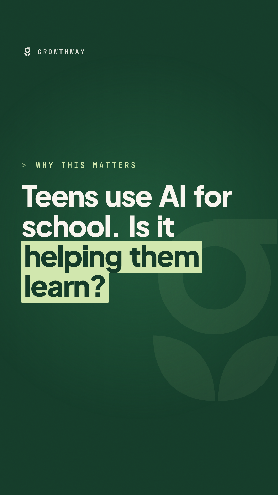

# Growthway daily brief

A new brief every weekday by 6:30am ET, with a branded reel on Tuesdays and Fridays.
Pick what you like, edit, post. Nothing here is posted automatically.
This week's briefs stay here until Monday, then move to "Last week". After that they're deleted.

## This week (from 2026-10-19)

---

## Sun, Oct 25

🎬 **Reel:** [reel.mp4](this-week/2026-10-25-sun/reel/reel.mp4) · [folder](this-week/2026-10-25-sun/reel)



```text
New international test data (OECD PISA 2025) asked 15-year-olds how they use AI chatbots for school. In Canada, 38% use them to help them learn at least once a week, and 18% use them to draft writing assignments.

A McGill education researcher who dug into the results found Canadian teens who use AI weekly for schoolwork scored about two years behind those who never use it. That's a link, not proof that AI caused it. But it's a strong signal that how teens use AI matters more than whether they use it.

Three questions to ask at home this week 👇 and if your school or parent council wants a plain-language AI night, that's what we do. Link in bio.

Sources: OECD, PISA 2025 Results (Volume I), Canada country note; Adam Dubé, McGill University, in The Conversation.

#AIinEducation #AIliteracy #PISA #K12 #CanadianEducation #Parenting #Growthway
```

_Test run (Sunday): scanned the 72 hours to Sunday evening, Oct. 25, plus a few days earlier where the new angle landed this week. Mostly quiet from the provinces._

**Top pick:** PISA 2025's AI questions, back in the news this week through a McGill researcher's analysis. 38% of Canadian 15-year-olds use AI chatbots weekly to help them learn, and he finds weekly users trailing non-users by about two years. That's the adoption–instruction gap with test scores attached.

### 1. PISA asked teens how they use AI for school, and the Canadian numbers are uncomfortable · score 8/10
OECD's PISA 2025 Canada note: 38% of Canadian students use AI chatbots at least weekly to help them learn (OECD average 46%), 23% to summarise a reading, 18% to draft writing assignments; 23% never or almost never use AI for these tasks (OECD 14%). McGill's Adam Dubé argues Canadian weekly users score two years behind non-users and calls for "teen-ready AI," not "AI-ready" teens; MobileSyrup picked it up Oct. 22. · [primary source (OECD Canada note, PDF)](https://www.oecd.org/content/dam/oecd/en/publications/reports/2026/09/pisa-2025-results-volume-i-country-notes_88d1164e/canada_71a0d70b/aa03e78f-en.pdf) · [Dubé in The Conversation](https://theconversation.com/the-release-of-ai-chatbots-has-harmed-teens-learning-and-canada-needs-to-act-293195) · [coverage](https://mobilesyrup.com/2026/10/22/mcgill-prof-chatbots-hurting-canadian-teens-education)
**Why it matters:** The first large, international read on *how* teens use AI for school; parents and teachers need a way to talk about use that helps vs. use that replaces the thinking.

⚠️ **Check before posting:** the "two years behind" and score gaps are Dubé's analysis, not the OECD's text, and they're correlational (he says so himself). I couldn't open the OECD's full chapter (blocked); search snippets suggest the OECD finds weekly users similar to non-users in science once socio-economic background is accounted for. Keep the "link, not proof" framing.
⚠️ **Positions:** Dubé reports Canadian students trained in AI use scored 2 points *lower* than non-users (5 higher globally). That pushes against Growthway's "practical AI literacy over bans" line. The drafts don't contradict it; they say literacy has to be about *how* AI is used, not a one-off course. Worth deciding before replying to anyone on this.

**Matt · Bluesky** (sharper)
```text
38% of Canadian 15-year-olds now use AI weekly to help them learn (PISA 2025). A McGill analysis finds weekly users ~2 years behind non-users. Correlation, not proof. But it's the adoption–instruction gap with test scores attached. Kids adopted. Schools still haven't taught how.
```
**Matt · Bluesky** (more measured)
```text
The new PISA data doesn't say "AI bad." It says how teens use it matters: summarising a reading or drafting an essay is not the same as using it to learn. That's exactly the conversation schools and parents haven't been equipped to have yet.
```
**Matt · X**
```text
38% of Canadian 15-year-olds use AI weekly to help them learn (PISA 2025). A McGill analysis finds weekly users ~2 yrs behind non-users. Correlation, not proof, but it's the adoption–instruction gap with scores attached.
```
Reply suggestion: The Conversation Canada (@ConversationCA), if they share Dubé's piece.

**Growthway · X**
```text
New OECD PISA 2025 data: 38% of Canadian 15-year-olds use AI chatbots at least weekly to help them learn (OECD avg 46%); 18% use them to draft writing assignments. What it means for schools: guidance has to cover how AI is used, not just whether. https://www.oecd.org/content/dam/oecd/en/publications/reports/2026/09/pisa-2025-results-volume-i-country-notes_88d1164e/canada_71a0d70b/aa03e78f-en.pdf
```
**Instagram:** today's reel (above) covers this. Carousel alternative:
1. How are Canadian teens using AI for school? New PISA data.
2. 38% use AI chatbots weekly to help them learn.
3. 23% use it to summarise readings; 18% to draft writing.
4. A McGill researcher links weekly use to lower scores. A link, not proof.
5. The difference: AI that explains vs. AI that does the work.
6. Ask your teen: "Could you redo this without AI?"
7. Growthway: parent nights on AI, in plain language.

### 2. Ontario votes for trustees Monday; at eight supervised boards, they won't take their seats · score 8/10
Ontario's municipal and school board elections are Monday, Oct. 26. Global News reports (Oct. 19) that trustees elected at five supervised public boards (TDSB, Peel, Ottawa-Carleton, Near North, Thames Valley) won't be sworn in until the province ends supervision, and a new regulation lets only the minister or the supervisor call a new board's first meeting; three supervised Catholic boards wait on the minister or supervisor too. The eight boards cover nearly 40% of Ontario's students. · [coverage](https://globalnews.ca/news/12108029/trustees-in-supervised-school-boards-wont-be-sworn-in-after-election-ford-government/) · [election date (DSBN)](https://dsbn.org/about/board-of-trustees/municipal-and-school-board-elections-2026)
**Why it matters:** Board AI policies, edtech procurement and phone rules at Ontario's biggest boards are being decided by provincial supervisors, not elected trustees, for now. Parents should know who to ask.

**Matt · Bluesky**
```text
Ontario elects school trustees Monday. At five supervised public boards, including TDSB, Peel and Ottawa-Carleton, they won't be sworn in until the province hands back control. Worth asking who's deciding AI and edtech policy for nearly 40% of Ontario students in the meantime.
```
**Matt · X**
```text
Ontario elects trustees Monday. At 5 supervised public boards (TDSB, Peel, OCDSB…) they won't be sworn in until the province ends supervision. So who decides AI and edtech policy for ~40% of Ontario students meanwhile?
```
**Growthway · X**
```text
Ontario school board elections are Monday, Oct. 26. At eight boards under provincial supervision (nearly 40% of students), newly elected trustees won't take their seats right away; only the minister or the supervisor can call the first meeting. https://globalnews.ca/news/12108029/trustees-in-supervised-school-boards-wont-be-sworn-in-after-election-ford-government/
```

### 3. Ottawa's new Children's Privacy Code: parental consent under 13, no profiling for ads, comments open to Jan. 20 · score 7/10
Privacy Commissioner Philippe Dufresne launched Canada's first Children's Privacy Code on Oct. 20: meaningful consent (parental consent for under-13s, opt-in for non-essential uses), age-appropriate privacy information, no profiling children for targeted ads, privacy by default, no deceptive design. The release doesn't mention schools or edtech. Comments are open until Jan. 20, 2027. · [primary source](https://www.priv.gc.ca/en/opc-news/news-and-announcements/2026/nr-c_261020) · [2025 regulators' edtech resolution](https://oipc.ab.ca/canadas-privacy-regulators-call-for-strong-protection-of-childrens-privacy-in-the-development-and-use-of-educational-technologies/)
**Why it matters:** The apps kids use at school are where much of their data gets collected; the consultation is a chance for boards and parents to ask that the Code speak to edtech explicitly.

**Matt · Bluesky**
```text
Canada now has a draft Children's Privacy Code: parental consent under 13, no ad profiling, privacy by default. Good. But the launch says nothing about the apps kids are required to use at school. Comments are open until Jan. 20. Educators should be in that consultation.
```
**Matt · X**
```text
Canada's new Children's Privacy Code: parental consent under 13, no ad profiling, privacy by default. Missing from the launch: the edtech kids must use at school. Comments open until Jan. 20; educators should weigh in.
```
**Growthway · X**
```text
The federal Privacy Commissioner has launched Canada's first Children's Privacy Code: meaningful consent (parental consent under 13), no profiling kids for targeted ads, privacy by default. Comments are open until Jan. 20, 2027; school boards can weigh in. https://www.priv.gc.ca/en/opc-news/news-and-announcements/2026/nr-c_261020
```

### 4. More Canadian schools ban phones, but distraction isn't linked to scores here · score 7/10
Same PISA Canada note: 37% of Canadian students attend schools that ban cell phones on the premises, up from 10% in PISA 2022 (OECD average 49%). 32% say peers are often distracted by devices in science class, but Canada is "among the minority" of systems where that distraction isn't associated with significant score differences. · [primary source (OECD Canada note, PDF)](https://www.oecd.org/content/dam/oecd/en/publications/reports/2026/09/pisa-2025-results-volume-i-country-notes_88d1164e/canada_71a0d70b/aa03e78f-en.pdf)
**Why it matters:** Phone bans are the policy everyone reached for; the evidence says Canada's harder problem may be how devices and AI are used for schoolwork, not just whether they're in the room. (Not fresh; hold for Friday's roundup or a quiet day.)

**Growthway · X**
```text
PISA 2025: 37% of Canadian students now attend schools that ban phones on the premises, up from 10% in 2022 (OECD avg 49%). Yet Canada is among the few systems where reported device distraction isn't linked to significant score differences. https://www.oecd.org/content/dam/oecd/en/publications/reports/2026/09/pisa-2025-results-volume-i-country-notes_88d1164e/canada_71a0d70b/aa03e78f-en.pdf
```

**Watchlist:**
- **Mon., Oct. 26:** Ontario municipal and school board elections.
- **Nov. 15 to ~22:** new Ontario trustee term begins; first meetings are due within seven days of Nov. 15, except where supervision delays them.
- **Jan. 20, 2027:** OPC Children's Privacy Code comments close.
- Ongoing: CTF (Oct. 14) wants the remaining *Essentials for Educators* chapters of the federal AI literacy program opened to educator review; watch for Amii releases this fall.
