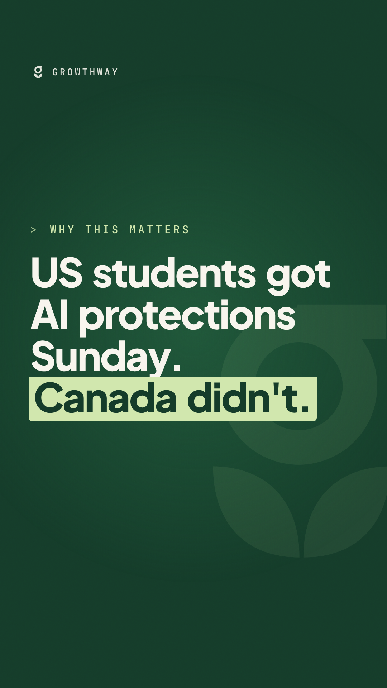

# Growthway daily brief

A new brief every weekday by 6:30am ET, with a branded reel on Tuesdays and Fridays.
Pick what you like, edit, post. Nothing here is posted automatically.
This week's briefs stay here until Monday, then move to "Last week". After that they're deleted.

## This week (from 2026-11-02)

---

## Thu, Nov 5

_Budget day: Champagne tables it this afternoon, after this brief, so the politics section is a pre-budget take and tomorrow's brief will have the real numbers. One education story (a follow-up with real news), and the Thursday Parreira.ca pitches._

**Top pick:** For Matt's Bluesky, budget day. The CCPA says the "productivity mega-deduction" is a corporate tax break worth $36 billion over five years, over $7 billion a year, with 40% of the benefit going to oil and gas and mining. Its list of what $7 billion a year could buy instead starts with a basic income for working-age Canadians in poverty ($9 billion). That's Matt's position, with a price tag.

### 1. Google's "no AI, no Search" plan for schools draws backlash; Google says schools can choose · score 8/10
After Google announced that Gemini, Gemini Notebook, Gemini in Classroom and Search will be off for K-12 student accounts until admins turn them on, its education VP Chris Phillips told The New York Times that "Search and AI are deeply integrated" and students at schools that don't opt in to AI "will not have access to search." Sen. Bernie Sanders called it "extortion"; former FTC chair Lina Khan called it "the danger of allowing an unregulated monopolist to control an essential service." Google then posted that "today's announcements give schools more choice, not less" and, per TechCrunch, that schools can turn on Gemini, Gemini Notebook and Search individually. TechCrunch notes the two statements aren't reconciled. · [coverage (TechCrunch)](https://techcrunch.com/2026/11/04/google-faces-backlash-for-plan-that-would-turn-off-search-for-schools-that-restrict-ai/) · [primary source (Google)](https://blog.google/products-and-platforms/products/education/ai-learning-era-updates-2026/)
**Why it matters:** Canadian boards on Google Workspace still don't know whether they can offer Search without AI, or when this reaches Canada. Get the answer in writing before changing any policy.

**Matt · Bluesky**
```text
Google says schools get "more choice, not less." Its own education VP says schools that don't opt in to AI lose Search. Both can't be true. Canadian boards: get Google's answer in writing before the switch, and decide your AI policy yourselves.
```
**Matt · X**
```text
Google says schools get "more choice, not less." Its own education VP says no AI, no Search. Both can't be true. Canadian boards: get the answer in writing before the switch.
```
**Growthway · X**
```text
Google says K-12 schools can turn on Gemini and Search individually; its education VP told the NYT schools that don't opt in to AI lose Search. For Canadian boards: ask Google in writing which applies here, and when. https://techcrunch.com/2026/11/04/google-faces-backlash-for-plan-that-would-turn-off-search-for-schools-that-restrict-ai/
```

## Politics (Matt · Bluesky only)

### P1. Budget day: what $7 billion a year could buy instead · score 10/10
CCPA economist David Macdonald writes (Nov. 4) that the productivity mega-deduction, announced in September, is "effectively a massive corporate tax break worth $36 billion over five years—over $7 billion a year," and that 40% of its benefits go to oil and gas and mining. Citing the Alternative Federal Budget, he lists what $7 billion a year could fund instead: a basic income for working-age Canadians in poverty ($9 billion), a Canada Child Benefit boost lifting 330,000 children out of poverty ($6.3 billion), primary care ($5.2 billion), the Canada Student Grant ($5.2 billion), and properly funding $10-a-day child care expansion ($4 billion). The PBO projects a $63.3-billion deficit for 2026-27 going in. · [primary source (CCPA)](https://www.policyalternatives.ca/news-research/canadas-federal-budget-is-about-to-give-billions-of-dollars-to-fossil-fuel-companies/) · [PBO outlook](https://www.pbo-dpb.ca/en/publications/RP-2627-011-S--economic-fiscal-outlook-october-2026--perspectives-economiques-financieres-octobre-2026)

⚠️ The budget is tabled this afternoon and may change the deduction or these costs. Post before it lands as a "what I'll be watching for" take, or wait and check tomorrow's brief.

**Matt · Bluesky** (sharper)
```text
Before today's budget: the "productivity mega-deduction" is a $7B-a-year corporate tax break, 40% to oil, gas and mining (CCPA). For $9B we could fund a basic income for working-age Canadians in poverty. A budget is a choice about who gets the break.
```
**Matt · Bluesky** (more measured)
```text
What I'm watching for in today's budget: does the $36B corporate mega-deduction stay as is? The CCPA estimates what the same money could do: $4B a year would properly fund $10-a-day child care, $5.2B would massively improve student grants. Those are choices too.
```

## Parreira.ca episode pitches

### "If I was finance minister for one budget" · politics
**Hook:** A board of budget envelopes labelled with sectors; Matt taps the fattest one, "Corporate tax breaks." *"Today Ottawa decides who gets $7 billion a year."*
**Tension:** a $36B five-year mega-deduction, 40% to oil and gas and mining ([CCPA](https://www.policyalternatives.ca/news-research/canadas-federal-budget-is-about-to-give-billions-of-dollars-to-fossil-fuel-companies/)); a $63.3B deficit going in ([PBO](https://www.pbo-dpb.ca/en/publications/RP-2627-011-S--economic-fiscal-outlook-october-2026--perspectives-economiques-financieres-octobre-2026)).
**Moves:** First, cap the mega-deduction to real productivity investments, not extraction. Then, put $4B a year into finishing $10-a-day child care. Finally, start a basic income for working-age people in poverty ($9B a year, CCPA's estimate).
**Screen:** a $7B stack sliced into labelled envelopes; an oil-derrick sticker with "40%" tape; a daycare and a cheque sticker filling in; a receipt printing "who got the break."
**Note:** re-check the numbers against the tabled budget before filming.

### "If I launched an AI-policy-in-a-box for school boards" · business
**Hook:** A board of school-board logos (generic) with blank policy sheets; Matt slaps a "SOLD OUT" sticker on one. *"Google just made every school board in Canada need the same document."*
**Tension:** Google is turning Gemini and Search off for K-12 students until admins choose, and its own messages on whether Search works without AI conflict ([Google](https://blog.google/products-and-platforms/products/education/ai-learning-era-updates-2026/), [TechCrunch](https://techcrunch.com/2026/11/04/google-faces-backlash-for-plan-that-would-turn-off-search-for-schools-that-restrict-ai/)).
**Moves:** First, a template AI-use policy, parent letter and vendor checklist each board can adapt. Then, a two-hour admin workshop to make the Workspace choices. Finally, an annual retainer to update it whenever a vendor changes the rules (they will).
**Screen:** a "policy in a box" sticker; three docs popping out; a Google-style toggle switch flipping; a calendar with renewal checkmarks.
**Note:** this is close to Growthway's own offer; decide whether Matt pitches it as Growthway or as a general business idea.

### "If I fixed student aid" · post-secondary
**Hook:** A board of student-loan statements; Matt crumples one. *"We keep asking students to borrow their way into the jobs we say we need."*
**Tension:** the CCPA prices a major Canada Student Grant improvement at $5.2 billion a year, the same as primary care and less than the mega-deduction ([CCPA](https://www.policyalternatives.ca/news-research/canadas-federal-budget-is-about-to-give-billions-of-dollars-to-fossil-fuel-companies/)).
**Moves:** First, grants, not loans, for students from low-income families. Then, free tuition in shortage programs (nursing, medicine, trades, ECE) in exchange for a few years of service. Finally, fund it from the corporate break, not from international fees.
**Screen:** a loan statement turning into a grant cheque; nurse, doctor, electrician and ECE cut-outs; a "$5.2B" tag next to a "$7B" tag.

**Watchlist:**
- **Today, Thu. Nov. 5:** federal budget (afternoon).
- **~Nov. 6:** B.C. final count; watch for B.C. cabinet and an education minister.
- **Google K-12 defaults:** watch for Canadian timing and a clear answer on Search without AI.
- **Quebec:** watch for the religious-symbols bill.
- **Nov. 15 to ~22:** new Ontario trustee term.
- **Jan. 20, 2027:** OPC Children's Privacy Code comments close.

---

## Wed, Nov 4

_One big story today, from Google; nothing new I could verify from the provinces. Budget is tomorrow (see watchlist)._

**Top pick:** Google says Gemini, Gemini Notebook, Gemini in Classroom and Google Search will be "entirely off for K-12 student accounts until school administrators explicitly turn them on." Reports say a school that keeps AI off would lose Search for students too. Every Canadian board on Google Workspace now has a decision to make, and it may not be a clean "AI or no AI" choice.

### 1. Google will switch off Search and Gemini for K-12 students until schools opt in · score 9/10
In a Nov. 3 post, Google's education VP Chris Phillips wrote that access to Gemini, Gemini Notebook, Gemini in Classroom and Google Search "will be entirely off for K-12 student accounts until school administrators explicitly turn them on," with specifics for schools "in the coming months." Guided Learning is now globally available in Google Classroom, and a Search pilot starts in select US schools this month. Google's post doesn't say whether Search can be turned on without its AI features, or whether the change applies outside the US. Secondary reports say Phillips told The New York Times that at a school that has banned AI, students "will not have access to search," and that Google later said on X that schools can turn the three services on individually. · [primary source (Google)](https://blog.google/products-and-platforms/products/education/ai-learning-era-updates-2026/) · [coverage (PPC Land)](https://ppc.land/google-will-cut-search-for-k-12-students-in-schools-that-keep-ai-off/)
**Why it matters:** Boards that limited AI may be about to lose student Search, or have to accept AI Mode and AI Overviews to keep it. Admins should ask Google now what the settings will be in Canada and when.

⚠️ **Check before posting:** the "no AI means no Search" line is reported, not in Google's own post, and Google's later clarification is only known second-hand. Keep that framing as "reports say."

**Matt · Bluesky** (sharper)
```text
Google is turning Search and Gemini off for K-12 students until schools opt in. Reports say schools that keep AI off lose Search too. That isn't a choice about AI. It's a choice about whether kids can look things up. Boards need a policy before Google writes one for them.
```
**Matt · Bluesky** (more measured)
```text
Google's new K-12 defaults put the decision where it belongs, with schools: Search and Gemini stay off until admins turn them on. But the details matter. Can you have Search without AI Overviews? Does this apply in Canada? Boards should be asking Google this week.
```
**Matt · X**
```text
Google is switching off Search and Gemini for K-12 students until schools opt in. Reports say keep AI off, lose Search. That's not an AI choice; it's a can-kids-look-things-up choice.
```
**Growthway · X**
```text
Google says Gemini, Gemini in Classroom and Search will be off for K-12 student accounts until admins turn them on; details due "in the coming months." For boards: ask Google whether Search works without AI, and when this reaches Canada. https://blog.google/products-and-platforms/products/education/ai-learning-era-updates-2026/
```
**Instagram** (carousel, "Why this matters"):
1. Google is changing how students get Search and AI at school.
2. Search and Gemini: off for K-12 students until the school turns them on.
3. Reports say no AI could mean no Search.
4. Parents: ask your school what it plans to turn on.
5. Ask whether AI answers come with Search.
6. Schools: decide your policy before the switch.
7. Growthway: plain-language AI policy help for boards.

### Lead to check (not drafted): what trustees at supervised Ontario boards can and can't do
CTV Toronto (Nov. 3, Bryann Aguilar) reports on a leaked memo setting out newly elected trustees' responsibilities at the supervised boards. The article body wouldn't load for me, so I have no details. · [CTV](https://ctvnews.ca/toronto/politics/queens-park/article/what-elected-trustees-at-supervised-school-boards-can-and-cant-do-according-to-a-leaked-memo)

**Watchlist:**
- **Thu. Nov. 5:** federal budget. For schools and post-secondary: AI literacy funding, student aid, child care transfers, health workforce training.
- **~Nov. 6:** B.C. final count; watch for B.C. cabinet and an education minister.
- **Google K-12 defaults:** watch for Canadian timing and Workspace admin details.
- **Quebec:** watch for the religious-symbols bill.
- **Nov. 15 to ~22:** new Ontario trustee term.
- **Jan. 20, 2027:** OPC Children's Privacy Code comments close.

---

## Tue, Nov 3

🎬 **Reel:** [reel.mp4](this-week/2026-11-03-tue/reel/reel.mp4) · [folder](this-week/2026-11-03-tue/reel)



```text
On Nov. 1, Microsoft's new student AI standards took effect across its US school contracts. They're legally binding, with third-party audits, and they bar AI companions or features "designed to foster emotional attachment or dependency," ban training AI on student or educator data (with a narrow exception for student safety), and stop that data being sold or used for ads.

They cover US schools. Canadian schools use the same tools, and our boards can ask for the same terms in their own contracts. Three questions every school leader can ask a vendor this week 👇 and if your board wants help writing AI and privacy terms, that's what we do. Link in bio.

Source: Euronews via Yahoo News, "Microsoft introduces AI guardrails for US schools amid growing backlash" (Sept. 15, 2026).

#AIinEducation #StudentPrivacy #EdTech #K12 #SchoolLeaders #CanadianEducation #Growthway
```

_Quiet for AI-and-schools news. One K-12 policy story out of Quebec, and today's reel explains the Microsoft student AI rules that took effect Sunday for US schools only. Budget is Thursday (see watchlist)._

**Top pick:** Quebec's new Parti Québécois government says banning conspicuous religious symbols for elementary students is "non négociable." No bill has been tabled yet, and a coalition of rights groups calls it state discrimination that undermines children's right to education.

### 1. Quebec confirms plan to ban religious symbols for elementary students · score 8/10
After the latest cabinet meeting, Education Minister Joël Arseneau confirmed the government intends to ban conspicuous religious symbols for elementary school students, calling it non-negotiable; no bill or timeline has been announced. In an Oct. 30 release, the Ligue des droits et libertés, the Canadian Civil Liberties Association and other groups called it state discrimination that would seriously undermine children's right to education and asked for the province's secularism laws (21, 94 and 9) to be withdrawn. Le Devoir reports Christian, Jewish, Muslim and Sikh community representatives oppose it. · [primary source (rights coalition release)](https://www.newswire.ca/fr/news-releases/interdiction-du-port-de-signes-religieux-par-les-eleves-des-ecoles-primaires-au-quebec-la-laicite-ne-doit-pas-servir-de-pretexte-pour-discriminer-et-bafouer-le-droit-a-l-education-des-enfants-846638022.html) · [coverage (Le Devoir)](https://www.ledevoir.com/politique/quebec/1020890/pq-accuse-attaquer-enfants-interdisant-signes-religieux-primaire)
**Why it matters:** It would make Quebec the first province to restrict what young students wear for religious reasons. Teachers and principals would be the ones enforcing it, with children.

⚠️ **Check before posting:** I read the coalition's release; I couldn't open Le Devoir or a government statement directly, and the government's wording comes via the release and other reports. There's no bill text yet, so details (private schools, enforcement) are unknown.
⚠️ **Positions / Growthway:** This is a strong political stance for Matt, consistent with his views but not yet in positions.md. Growthway has no position on secularism laws; its draft just reports, and skipping it on the Growthway account is reasonable.

**Matt · Bluesky** (sharper)
```text
Quebec's new government says banning religious symbols for elementary kids is "non-negotiable." For children in elementary school. A school's job is to welcome every child and teach them, not to make some of them choose between their faith and their classroom.
```
**Matt · Bluesky** (more measured)
```text
Quebec plans to ban conspicuous religious symbols for elementary students. No bill yet, but think about who enforces it: teachers and principals, with children. That's a hard thing to ask of schools that are supposed to be where every kid belongs.
```
**Matt · X**
```text
Quebec's government says banning religious symbols for elementary students is "non-negotiable." A school's job is to welcome every child, not make some choose between faith and class.
```
**Growthway · X**
```text
Quebec's education minister has confirmed plans to ban conspicuous religious symbols for elementary students. No bill has been tabled yet. Rights groups including the CCLA oppose it. What it means for schools: details on enforcement are still unknown. https://www.newswire.ca/fr/news-releases/interdiction-du-port-de-signes-religieux-par-les-eleves-des-ecoles-primaires-au-quebec-la-laicite-ne-doit-pas-servir-de-pretexte-pour-discriminer-et-bafouer-le-droit-a-l-education-des-enfants-846638022.html
```

**Watchlist:**
- **Thu. Nov. 5:** federal budget. For schools and post-secondary: AI literacy funding, student aid, child care transfers, health workforce training.
- **~Nov. 6:** B.C. final count; watch for B.C. cabinet and an education minister.
- **Quebec:** watch for the religious-symbols bill and whether it covers private schools.
- **Nov. 15 to ~22:** new Ontario trustee term.
- **Alberta Bills 33 and 35:** debate this fall.
- **Jan. 20, 2027:** OPC Children's Privacy Code comments close.

---

## Mon, Nov 2

_Quiet weekend (72-hour scan): no new AI-and-schools story I could verify from a primary source, so there are no education drafts today. One strong lead is below for you to check, and Thursday's federal budget leads the politics section._

**Top pick:** Thursday's federal budget (Nov. 5). The PBO projects a $63.3-billion deficit for 2026-27 and defence spending rising from $75 billion a year to $95.7 billion by 2030-31. It's a good moment for Matt to say what a budget built for people would fund.

### Lead to check (not drafted): Ottawa's $13M AI course, partly AI-generated?
Le Devoir has run a series on the federal "L'IA pour tous" (AI for All) literacy course delivered by Amii: that it was awarded a roughly $13-million contract without a tender, that parts of it appear to have been generated by AI, and that the French version was poor until Amii corrected it after the paper's questions. ISED reportedly hasn't confirmed the absence of a tender. I couldn't open any of the articles (the site blocks automated reads), so nothing here is verified and there are no drafts. If you can read them, this is a strong story for Matt and Growthway: an AI literacy course for 50,000 K-12 educators that may have been made with the shortcuts it's meant to teach about. · [Le Devoir: no-tender contract](https://www.ledevoir.com/politique/canada/1018337/ottawa-accorde-gre-gre-contrat-13-millions-formations-ia-generees-ia) · [Le Devoir: French and AI generation](https://www.ledevoir.com/politique/canada/1015616/ottawa-paie-millions-formation-ia-generee-ia-bafoue-francais) · [Le Devoir: disclosure](https://www.ledevoir.com/politique/canada/1017332/ottawa-garde-secret-usage-fait-ia-formation-ia)

## Politics (Matt · Bluesky only)

### P1. Budget Thursday: the PBO's numbers going in · score 9/10
Finance Minister François-Philippe Champagne tables the federal budget on Nov. 5, the second under Prime Minister Carney. The Parliamentary Budget Officer's October outlook projects a $63.3-billion deficit in 2026-27 and $67.8 billion in 2030-31, with debt-to-GDP rising from 40.8% to 42.6% over that period; it says the government will miss its anchor of a declining deficit-to-GDP ratio. CP24, citing the PBO, reports defence spending rising from $75 billion a year to $95.7 billion by 2030-31. · [primary source (PBO, Oct. 20)](https://www.pbo-dpb.ca/en/publications/RP-2627-011-S--economic-fiscal-outlook-october-2026--perspectives-economiques-financieres-octobre-2026) · [coverage (CP24)](https://www.cp24.com/politics/2026/10/20/finance-minister-announces-date-for-new-federal-budget-to-be-tabled/)

⚠️ The budget itself may change these numbers; re-check after Thursday before reusing any figure.

**Matt · Bluesky** (sharper)
```text
Thursday's budget: defence is set to rise from $75B to $95.7B a year by 2030-31 (PBO). If we can find that kind of money for defence, we can find it for free training for nurses and doctors, child care spaces and homes. A budget is a list of who we decided matters.
```
**Matt · Bluesky** (more measured)
```text
Going into Thursday's budget, the PBO projects a $63.3B deficit and rising debt-to-GDP. Fine: deficits are choices. The question is what they buy. I'll be reading for health workforce training, child care spaces, housing and post-secondary, not just tax cuts and defence.
```

**Watchlist:**
- **Thu. Nov. 5:** federal budget. For schools and post-secondary: AI literacy funding, student aid, child care transfers, health workforce training.
- **~Nov. 6:** B.C. final count; watch for B.C. cabinet and an education minister.
- **Nov. 15 to ~22:** new Ontario trustee term; first meetings, except at the eight supervised boards.
- **Alberta Bills 33 and 35:** debate this fall.
- **C-34:** watch for a committee and witness list.
- **Jan. 20, 2027:** OPC Children's Privacy Code comments close.

---

## Last week

- [Fri, Oct 30](last-week/2026-10-30-fri/brief.md) · [reel](last-week/2026-10-30-fri/reel/reel.mp4)
- [Thu, Oct 29](last-week/2026-10-29-thu/brief.md)
- [Wed, Oct 28](last-week/2026-10-28-wed/brief.md)
- [Tue, Oct 27](last-week/2026-10-27-tue/brief.md) · [reel](last-week/2026-10-27-tue/reel/reel.mp4)
- [Mon, Oct 26](last-week/2026-10-26-mon/brief.md)
